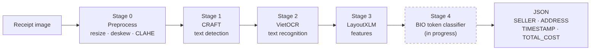
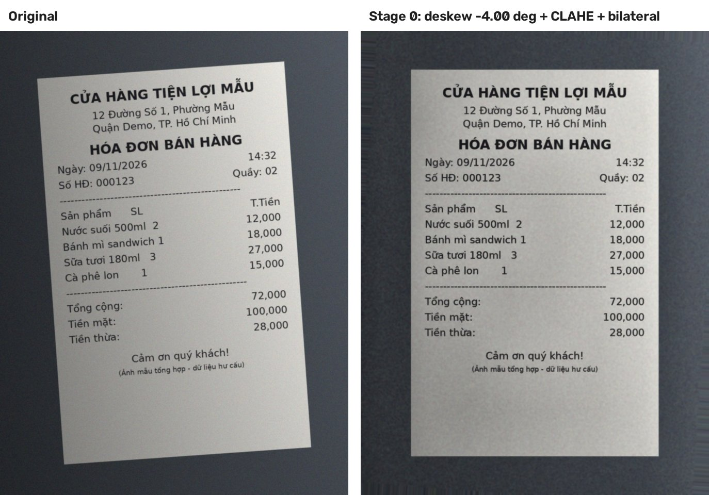

# QuetHoaDon - Vietnamese Receipt OCR & KIE

[](https://github.com/CaoLePhucThinh2203/QuetHoaDon/actions/workflows/tests.yml)

Read a photo of a Vietnamese receipt and extract structured information (seller, address, timestamp, total) with a
**CRAFT → VietOCR → LayoutXLM** pipeline.



> **Status (Week 4 done, moving to Week 5).** The full pipeline runs: preprocessing → CRAFT → VietOCR → LayoutXLM
> features → field extraction. Three systems were trained and scored on the same OCR output and split: baseline B0
> (Week 3 pipeline), M1a (frozen LayoutXLM + linear head) and M1b (fine-tuned LayoutXLM). On the test split M1b reaches
> macro F1 0.658 against 0.352 for B0, see [Results](#results-week-4-one-seed). Still open: an end-to-end demo,
> OCR fine-tuning (RQ1), the spending-category classifier and more seeds. Plan and status:
> [`docs/reports/`](docs/reports/).

## Quickstart (3 commands)

```bash
git clone https://github.com/CaoLePhucThinh2203/QuetHoaDon.git && cd QuetHoaDon
pip install -r requirements.txt && pip install craft-text-detector vietocr --no-deps \
    && pip install gdown einops prefetch_generator albumentations lmdb imgaug
python scripts/run_pipeline.py --image assets/samples/sample_receipt.jpg --output outputs/sample_receipt.json
```

The last command preprocesses the bundled sample, detects text with CRAFT, reads it with VietOCR and prints the
OCR result as JSON (text, confidence and box of every line in reading order, plus per-stage timing). It runs on CPU
or GPU (`--device auto|cpu|cuda`); pretrained weights are downloaded on first use. To run only the unit
tests, see [5.3](#53-unit-tests-no-gpu).

## Problem statement

Entering expenses by hand is slow and error-prone, so many people give up tracking their spending. This project
combines OCR and Key Information Extraction to read photos of Vietnamese retail receipts, extract the seller,
address, date and total, and assign the receipt to a spending category (food / move / study / shop / other).

- **RQ1 (Robustness):** How much do image preprocessing (denoising, lighting/contrast correction) and data
  augmentation improve text recognition on blurred, wrinkled or poorly lit receipts?
- **RQ2 (Extraction & classification):** Which model architecture extracts the total amount most accurately and
  best assigns receipts to standard spending categories?
- **RQ3 (Efficiency & latency):** What is the trade-off between accuracy and response time across the compared models?

## 1. Source code

All logic lives in `src/`, one package per pipeline stage; notebooks and scripts only call it.

| Stage | Module | Status |
| --- | --- | --- |
| 0 Preprocessing | `src/preprocessing/image_preprocessor.py` | implemented, unit-tested |
| 1 Detection (CRAFT) | `src/detection/` | implemented; logic unit-tested, model call verified on Colab |
| 2 OCR (VietOCR) | `src/recognition/` | implemented; logic unit-tested, model call verified on Colab |
| 3 Features (LayoutXLM) | `src/features/` | implemented, not unit-tested end to end |
| 4 Field extraction | `src/extraction/`, `src/training/` | BIO decoding, soft decoding and keyword / date rules; M1b and M1a trained and scored (Kaggle T4) |
| Baseline B0 | `src/baseline/b0.py` | frozen features + K-means + cluster-to-field mapping; scored on validation and test |
| Orchestration | `src/pipeline/runner.py` | `ReceiptPipeline.predict()` (one image, OCR only), `.run()` (dataset, resumable) |
| Evaluation | `src/evaluation/`, `src/training/field_eval.py` | CER/WER, detection recall, field P/R/F1 (strict and OCR-tolerant), bootstrap CI, error causes |
| Shared | `src/common/` | bbox utilities, config loader |

```text
QuetHoaDon/
├── .github/workflows/tests.yml   # CI: unit tests on every push / PR
├── assets/
│   ├── pipeline_architecture.png
│   ├── preprocessing_before_after.jpg
│   └── samples/sample_receipt.jpg  # synthetic receipt for a quick test
├── configs/                      # config.yaml (paths, data policy), dataset.yaml, model.yaml
├── docs/
│   ├── architecture.md           # pipeline, data contracts, model architecture, limits
│   ├── dataset.md                # MC-OCR facts, preprocessing steps, split, data-use policy
│   ├── training.md               # how to train, score and compare the models (commands, settings)
│   ├── archive/                  # documents of the earlier unsupervised direction (history only)
│   └── reports/                  # project plan, status, weekly reports
├── notebooks/
│   ├── 01_mc_ocr_eda.ipynb       # dataset audit
│   ├── 02_pipeline_colab.ipynb   # full OCR run on the dataset (Colab GPU)
│   ├── 03_train_evaluate_kaggle.ipynb  # training, scoring and comparison (Kaggle T4)
│   ├── 04_week5_demo_latency_rq1_kaggle.ipynb  # end-to-end demo, latency, preprocessing ablation (Kaggle T4)
│   └── 05_phase0_baseline_kaggle.ipynb  # accuracy baseline: strict app metrics, saved probabilities, error catalogue
├── scripts/
│   ├── prepare_dataset.py        # manifests + invoice-level split
│   ├── build_token_dataset.py    # OCR JSON + annotations -> BIO token dataset
│   ├── run_pipeline.py           # one image -> OCR JSON (CLI entrypoint)
│   ├── train_layoutxlm.py        # M1b (fine-tune) and M1a (--freeze-encoder)
│   ├── run_baseline_b0.py        # baseline B0 (features, K-means, cluster-to-field)
│   ├── evaluate_layoutxlm.py     # field-level scoring of a checkpoint
│   ├── compare_models.py         # comparison table with paired bootstrap
│   ├── error_analysis.py         # error causes per field
│   ├── find_duplicates.py        # near-duplicate receipts across splits
│   ├── rescore_without_duplicates.py
│   ├── aggregate_seeds.py        # mean and standard deviation over seeds
│   ├── draw_errors.py            # draw wrong fields on the receipt for manual review
│   ├── extract_receipt.py        # end-to-end demo: photo -> four fields with M1b
│   ├── measure_latency.py        # latency and size of B0 / M1a / M1b on GPU and CPU
│   ├── ocr_preprocessing_ablation.py  # RQ1: preprocessing vs VietOCR error rate
│   ├── verify_extractor.py       # the demo path must reproduce the scored Week-4 predictions
│   ├── decode_from_probs.py      # decode saved word probabilities offline, strict app scores, error table
│   ├── score_app_metrics.py      # strict reading accuracy of saved reports
│   └── ocr_error_catalog.py      # first sort of OCR-text errors for the manual review
├── src/                          # source code (table above)
├── tests/                        # 150+ unit tests, no GPU needed
├── requirements.txt              # runtime (pipeline)
└── requirements-dev.txt          # light deps for the unit tests / CI
```

## 2. Documentation

- [`docs/architecture.md`](docs/architecture.md) - stages, classes and parameters, JSON data contracts,
  LayoutXLM architecture, field-extraction design, limitations.
- [`docs/dataset.md`](docs/dataset.md) - MC-OCR 2021 annotations, preprocessing steps, split figures, known
  issues, data-use policy (train / validation / test).
- [`docs/reports/`](docs/reports/) - project plan with the rubric check, latest status, weekly reports.

## 3. Data preprocessing steps

Dataset: [MC-OCR 2021](https://www.kaggle.com/datasets/domixi1989/vietnamese-receipts-mc-ocr-2021) (Kaggle,
`domixi1989/vietnamese-receipts-mc-ocr-2021`). It is not stored in the repo.

**Step 1 - clean annotations, manifests and an invoice-level 80/10/10 split** (`src/preprocessing/annotation_parser.py`,
`dataset_preparer.py`): parses the `|||`-separated texts/labels/polygons, fixes the `TOTAL_TOTAL_COST` label typo,
drops empty / invalid records and checks that every image exists.

```bash
python scripts/prepare_dataset.py --csv <dataset>/mcocr_train_df.csv \
    --images <dataset>/train_images/train_images --out outputs/dataset
```

**Step 2 - image preprocessing + OCR** (Stage 0-2, run by `notebooks/02_pipeline_colab.ipynb`): resize to 1280 px,
deskew, CLAHE + bilateral filter, then CRAFT + VietOCR; one `<id>.json` per image.



**Step 3 - BIO token dataset for LayoutXLM** (`src/preprocessing/token_dataset.py`): splits OCR lines into words,
normalises boxes to [0, 1000], gives each word the label of the annotation polygon that contains it and writes
`train/validation/test.jsonl` plus a label-coverage report.

```bash
python scripts/build_token_dataset.py --csv <dataset>/mcocr_train_df.csv \
    --ocr-dir pipeline_results/ocr_annotations \
    --split-manifest outputs/dataset/mcocr_manifest_split.csv --out outputs/token_dataset_v1
```

Details: [`docs/dataset.md`](docs/dataset.md#preprocessing-steps).

## Results (Week 4, one seed)

Field-level macro F1 on the held-out test split (116 receipts; lenient matching, 95 % bootstrap interval):

| Model | Macro F1 | Receipts with all fields right |
| --- | --- | --- |
| B0: Week 3 pipeline (frozen features + clustering + rules) | 0.352 [0.32, 0.39] | 0 / 116 |
| M1a: frozen LayoutXLM + linear head | 0.638 [0.58, 0.69] | 30 / 116 |
| M1b: fine-tuned LayoutXLM | 0.658 [0.60, 0.71] | 32 / 116 |

About 70 % of the remaining errors come from OCR text or annotations. Roughly 10 % of validation / test receipts have a
near-duplicate in train (macro F1 without them: M1b 0.642). How to train and score: [`docs/training.md`](docs/training.md).

## 4. Model development notebooks / scripts

| Notebook / script | Purpose | Where |
| --- | --- | --- |
| `notebooks/01_mc_ocr_eda.ipynb` | dataset audit: label taxonomy, missing images, resolutions, entity counts, samples | Kaggle / local |
| `notebooks/02_pipeline_colab.ipynb` | install → build pipeline from `configs/` → 5-image smoke test → full resumable run → inspect a result | Colab GPU |
| `notebooks/03_train_evaluate_kaggle.ipynb` | train M1b / M1a, run B0, score, compare, error analysis | Kaggle GPU |
| `notebooks/04_week5_demo_latency_rq1_kaggle.ipynb` | end-to-end demo, latency (RQ3), preprocessing ablation (RQ1), duplicate check | Kaggle GPU |
| `scripts/run_pipeline.py` | the same pipeline on one image from the terminal | any |
| `scripts/extract_receipt.py` | receipt photo → seller, address, date, total with the fine-tuned model | GPU |
| `scripts/train_layoutxlm.py`, `run_baseline_b0.py`, `evaluate_layoutxlm.py`, `compare_models.py` | train and score the three systems | GPU for training and scoring |

Models: CRAFT and VietOCR (`vgg_transformer`) are pretrained and used for inference only; LayoutXLM-base
(`microsoft/layoutxlm-base`) is fine-tuned for BIO token classification on the token dataset (M1b), or used with a
frozen encoder and a trained linear head (M1a). Commands and settings: [`docs/training.md`](docs/training.md).
Preprocessing and detection hyper-parameters are in `configs/model.yaml`.

**Evaluation (what MC-OCR can and cannot measure).** MC-OCR annotates only `SELLER`, `ADDRESS`, `TIMESTAMP`,
`TOTAL_COST`, so: field-level P/R/F1 and exact match on those four fields; detection **recall** on annotated regions
(precision is not measurable); CER/WER on matched regions; `ITEM_NAME`, `ITEM_PRICE`, `QUANTITY` only qualitatively.

## 5. Instructions for running the project

### 5.1 One image (CLI)

Install as in the [Quickstart](#quickstart-3-commands), then:

```bash
python scripts/run_pipeline.py                                    # bundled sample, prints JSON
python scripts/run_pipeline.py --image path/to/receipt.jpg --output outputs/receipt.json --device cpu
```

`craft-text-detector` and `vietocr` must be installed with `--no-deps` (they pin old torch/numpy versions); see the
comments in `requirements.txt`.

### 5.2 Full dataset (Colab GPU)

Open `notebooks/02_pipeline_colab.ipynb`, run the install cells (they also build detectron2 for LayoutXLM), then
the **smoke test** (5 images) before the full run. The runner resumes after a disconnect and stops early if more than
half of the first images fail. Then run Step 1 and Step 3 of [section 3](#3-data-preprocessing-steps).

### 5.3 Unit tests (no GPU)

```bash
pip install -r requirements-dev.txt
python -m unittest discover -s tests -t . -v
```

The same command runs in CI on every push / pull request.

### 5.4 Reproducibility

The reported results were produced on a Kaggle notebook (GPU T4, Internet on) with the versions below; other versions
may need small changes, especially transformers 5.x for the LayoutXLM processor.

| Component | Version used |
| --- | --- |
| Python | 3.13 |
| torch | 2.11 (CUDA 13 build) |
| transformers | 5.20 |
| detectron2 | built from source each session, about 5 - 10 minutes |
| Seed | 42 for every reported run |

Order: run the OCR notebook, then `prepare_dataset.py` and `build_token_dataset.py` ([section 3](#3-data-preprocessing-steps)),
then the commands in [`docs/training.md`](docs/training.md). Model weights are not stored in the repository; retrain with
the M1b v2 command in that file (about 30 minutes on a T4).

## Team

| # | Full name | Student ID |
| --- | --- | --- |
| 1 | Dam Huynh Hoai Nam | 24090022 |
| 2 | Cao Le Phuc Thinh | 24090024 |
| 3 | Dau Tuan Loc | 24090025 |
| 4 | Truong Dinh Nhien | 24090060 |
