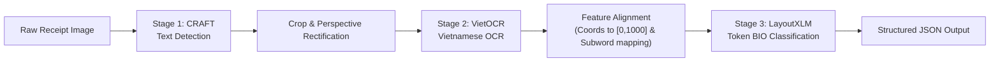

# AI Invoice Intelligence

An AI-powered invoice recognition and key information extraction (KIE) system tailored for Vietnamese mobile-captured receipts and invoices.

---

## 📌 Project Overview

Processing real-world Vietnamese receipts introduces significant computer vision and NLP challenges: severe perspective distortions, uneven lighting, faded ink, wrinkled paper, and complex multilingual layouts with full Vietnamese diacritics.

This project implements an end-to-end multi-modal deep learning pipeline:
1. **Text Detection (CRAFT):** Localizes arbitrary-oriented text lines and words via character affinity heatmaps.
2. **Text Recognition (VietOCR):** Converts cropped image patches into Unicode Vietnamese strings preserving tone marks and vowel modifiers.
3. **Key Information Extraction (LayoutXLM):** Jointly models 2D spatial arrangements and multilingual semantic representations to extract target entities:
   - **`SELLER`**: Store or company name.
   - **`ADDRESS`**: Merchant address or branch location.
   - **`TIMESTAMP`**: Transaction date and time.
   - **`TOTAL_COST`**: Final total amount payable.

---

## 🏗️ System Architecture



For complete technical specifications, see [System Architecture Specification](docs/architecture.md).

---

## 📂 Repository Layout

```text
ai-invoice-intelligence/
├── README.md                          # Project documentation and quickstart
├── requirements.txt                   # Core project dependencies
├── .gitignore                         # Data, model weights, and credential exclusion
├── configs/                           # Central configuration files
│   ├── config.yaml                    # Runtime environment & paths
│   ├── dataset.yaml                   # MC-OCR label schema & split rules
│   └── model.yaml                     # Model hyperparameters (CRAFT, VietOCR, LayoutXLM)
├── docs/                              # Detailed engineering documentation
│   ├── architecture.md                # 3-stage model pipeline & tokenizer analysis
│   ├── dataset_documentation.md       # MC-OCR 2021 schema, access & licensing
│   └── preprocessing.md               # Coordinate normalization & BIO alignment
├── notebooks/                         # Interactive workflows
│   └── kaggle/
│       └── 01_mc_ocr_eda.ipynb        # MC-OCR exploratory data analysis & verification
├── src/                               # Modular Python source package
│   ├── common/                        # Geometric & bounding box utilities
│   │   └── bbox_utils.py              # Normalization [0,1000], IoU, polygon conversions
│   ├── preprocessing/                 # Annotation parsing & data cleaning
│   │   └── annotation_parser.py       # Safe deserialization & anomaly correction
│   ├── detection/                     # CRAFT detector interfaces
│   │   └── detector.py
│   ├── recognition/                   # VietOCR recognizer interfaces
│   │   └── recognizer.py
│   └── extraction/                    # LayoutXLM schemas & token classification
│       └── schema.py                  # BIO labeling scheme (9 classes)
├── tests/                             # Unit tests
│   ├── test_bbox_utils.py             # Geometric transformations & invariant assertions
│   ├── test_annotation_parser.py      # Anomaly & empty row parsing tests
│   └── test_schema.py                 # Label encodings & bijective mapping tests
└── reports/                           # Academic & milestone reports
    └── week3_progress_report.md       # Week 3 Progress Report
```

---

## 🚀 Quickstart & Setup

### 1. Local Environment Setup (Lightweight)

Clone the repository and install core dependencies:
```bash
git clone https://github.com/kitalikedev/ai-invoice-intelligence.git
cd ai-invoice-intelligence

# Install dependencies
pip install -r requirements.txt
```

### 2. Running Unit Tests

Run the full automated test suite:
```bash
python3 -m unittest discover -s tests -v
```

### 3. Kaggle Training & EDA Workflow

Model training and heavy GPU workloads are executed on Kaggle:
1. Open [Kaggle Notebooks](https://www.kaggle.com/code).
2. Create a new notebook and click **Add Input** in the right-hand panel.
3. Search and attach the dataset: **`domixi1989/vietnamese-receipts-mc-ocr-2021`**.
4. Import and execute `notebooks/kaggle/01_mc_ocr_eda.ipynb`.
5. The notebook automatically detects dataset paths, validates annotations, displays sample visualizations, and exports `mc_ocr_data_quality_report.json` to `/kaggle/working/`.

---

## 📊 Dataset: MC-OCR 2021

- **Source:** MC-OCR 2021 Challenge (IEEE RIVF 2021).
- **Scale:** 1,155 annotated training receipts, 391 validation images.
- **License:** Non-commercial academic research and benchmarking.
- **Data Governance:** In compliance with project security guidelines, all raw images and annotations are stored in Kaggle and strictly gitignored locally under `data/`.

For complete details, see [Dataset Documentation](docs/dataset_documentation.md).

---

## 👥 Team & Responsibilities

- **Member 1 (Project Lead & MLOps):** Repository architecture, Git governance, interface contracts, report compilation.
- **Member 2 (Data Engineering):** Kaggle dataset ingestion, exploratory analysis, store-grouped train/val splitting.
- **Member 3 (Vision & OCR):** CRAFT text detection, image rectification, VietOCR character/word error rate benchmarks.
- **Member 4 (Information Extraction):** LayoutXLM tokenizer alignment, BIO label generation, token classification baseline.

---

## 🛡️ Team Collaboration & Git Workflow

To ensure code quality, dataset safety, and prevent regressions, all team contributions must strictly follow this collaborative workflow:

### 1. Protected Branch Rules
- **`main` is the protected integration branch:** Direct pushes to `main` are strictly forbidden.
- **Pull Requests (PR) Only:** All changes must be integrated into `main` via a GitHub Pull Request.
- **Code Owner Review:** Approval from the Code Owner (`@kitalikedev`, defined in `.github/CODEOWNERS`) is required before any PR can be merged.
- **CI / Local Verification:** All unit tests must pass (`python3 -m unittest discover -s tests -v`) before requesting a PR review.
- **Zero-Data Policy:** Never commit raw datasets, images, CSVs, model weights (`*.pth`), or credentials (`kaggle.json`, `.env`) to Git.

### 2. Branch Naming Convention
Branches must be created from the latest `main` branch using structured prefixes:
- `feat/<feature-name>`: New model components, pipeline stages, or utilities (e.g., `feat/vietocr-wrapper`).
- `fix/<bug-name>`: Bug fixes or data alignment corrections (e.g., `fix/total-cost-normalization`).
- `docs/<doc-name>`: Documentation, architecture specs, or report updates (e.g., `docs/multi-dataset-spec`).
- `test/<test-name>`: New unit tests or validation suites (e.g., `test/bbox-clamping`).
- `data/<dataset-name>`: Dataset ingestion scripts or adapters (e.g., `data/sroie-adapter`).

### 3. Commit Message Convention
Follow the [Conventional Commits](https://www.conventionalcommits.org/) standard:
```text
<type>(<scope>): <concise description in imperative mood>

[optional body explaining context and trade-offs]
```
- `feat`: A new feature or model capability.
- `fix`: A bug fix.
- `docs`: Documentation changes only.
- `test`: Adding or modifying tests.
- `refactor`: Code refactoring that neither fixes a bug nor adds a feature.
- `chore`: Maintenance tasks, `.gitignore` updates, dependency changes.

*Example:* `feat(extraction): add 9-class BIO schema and token label mapping`

---

## 📄 Documentation Links

- [System Architecture](docs/architecture.md)
- [Multi-Dataset Architecture (MC-OCR, SROIE, CORD)](docs/multi_dataset_architecture.md)
- [Dataset Documentation](docs/dataset_documentation.md)
- [Preprocessing & Token Alignment](docs/preprocessing.md)
- [Week 3 Progress Report](reports/week3_progress_report.md)
