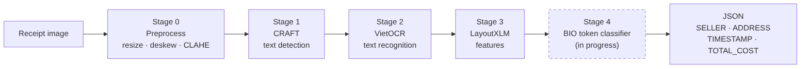
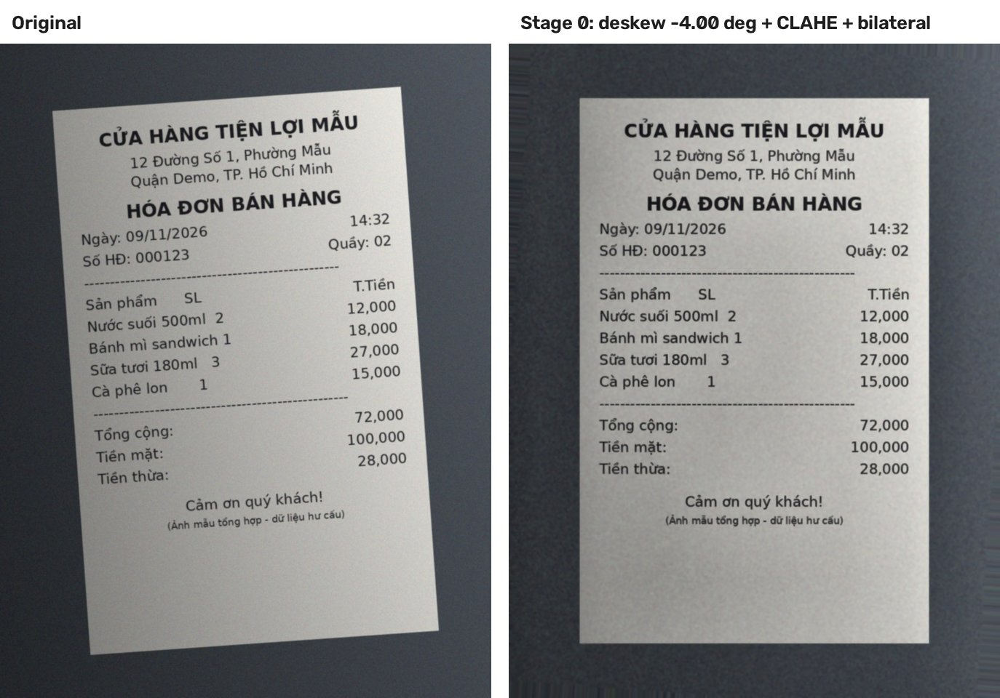

# QuetHoaDon - Vietnamese Receipt OCR & KIE

[](https://github.com/CaoLePhucThinh2203/QuetHoaDon/actions/workflows/tests.yml)

Read a photo of a Vietnamese receipt and extract structured information (seller, address, timestamp, total) with a
**CRAFT → VietOCR → LayoutXLM** pipeline.



> **Status (10/11/2026, Week 3 → 4).** Stages 0–3 (preprocessing, detection, OCR, LayoutXLM features) are
> implemented in `src/` and unit-tested. Stage 4 (fine-tuned LayoutXLM token classifier) is in progress: the BIO
> token dataset and the decoding code exist, **no model has been trained yet and no metrics have been measured.**
> Plan and status: [`docs/reports/`](docs/reports/).

## Quickstart (3 commands)

```bash
git clone https://github.com/CaoLePhucThinh2203/QuetHoaDon.git && cd QuetHoaDon
pip install -r requirements.txt && pip install craft-text-detector vietocr --no-deps \
    && pip install gdown einops prefetch_generator albumentations lmdb imgaug
python scripts/run_pipeline.py --image assets/samples/sample_receipt.jpg --output outputs/sample_receipt.json
```

The last command preprocesses the bundled sample, detects text with CRAFT, reads it with VietOCR and prints the
OCR result as JSON (text, confidence and box of every line in reading order, plus per-stage timing). It runs on CPU
or GPU (`--device auto|cpu|cuda`); pretrained weights are downloaded on first use. To run only the unit
tests, see [5.3](#53-unit-tests-no-gpu).

## Problem statement

Entering expenses by hand is slow and error-prone, so many people give up tracking their spending. This project
combines OCR and Key Information Extraction to read photos of Vietnamese retail receipts, extract the seller,
address, date and total, and assign the receipt to a spending category (food / move / study / shop / other) for the
FinBud app.

- **RQ1 (Robustness):** How much do image preprocessing (denoising, lighting/contrast correction) and data
  augmentation improve text recognition on blurred, wrinkled or poorly lit receipts?
- **RQ2 (Extraction & classification):** Which model architecture extracts the total amount most accurately and
  best assigns receipts to standard spending categories?
- **RQ3 (Efficiency & latency):** What is the trade-off between accuracy and response time across the compared models?

## 1. Source code

All logic lives in `src/`, one package per pipeline stage; notebooks and scripts only call it.

| Stage | Module | Status |
| --- | --- | --- |
| 0 Preprocessing | `src/preprocessing/image_preprocessor.py` | implemented, unit-tested |
| 1 Detection (CRAFT) | `src/detection/` | implemented; logic unit-tested, model call verified on Colab |
| 2 OCR (VietOCR) | `src/recognition/` | implemented; logic unit-tested, model call verified on Colab |
| 3 Features (LayoutXLM) | `src/features/` | implemented, not unit-tested end to end |
| 4 Field extraction | `src/extraction/` | output schema + BIO decoding done; classifier not trained yet |
| Orchestration | `src/pipeline/runner.py` | `ReceiptPipeline.predict()` (one image), `.run()` (dataset, resumable) |
| Evaluation | `src/evaluation/metrics.py` | CER/WER, detection recall, field P/R/F1; not yet run on real predictions |
| Shared | `src/common/` | bbox utilities, config loader |

```text
QuetHoaDon/
├── .github/workflows/tests.yml   # CI: unit tests on every push / PR
├── assets/
│   ├── pipeline_architecture.png
│   ├── preprocessing_before_after.jpg
│   └── samples/sample_receipt.jpg  # synthetic receipt for a quick test
├── configs/                      # config.yaml (paths, data policy), dataset.yaml, model.yaml
├── docs/
│   ├── architecture.md           # pipeline, data contracts, model architecture, limits
│   ├── dataset.md                # MC-OCR facts, preprocessing steps, split, data-use policy
│   └── reports/                  # project plan, status, weekly reports
├── notebooks/
│   ├── 01_mc_ocr_eda.ipynb       # dataset audit
│   └── 02_pipeline_colab.ipynb   # full OCR run on the dataset (Colab GPU)
├── scripts/
│   ├── prepare_dataset.py        # manifests + invoice-level split
│   ├── build_token_dataset.py    # OCR JSON + annotations -> BIO token dataset
│   └── run_pipeline.py           # one image -> JSON (CLI entrypoint)
├── src/                          # source code (table above)
├── tests/                        # 100+ unit tests, no GPU needed
├── requirements.txt              # runtime (pipeline)
└── requirements-dev.txt          # light deps for the unit tests / CI
```

## 2. Documentation

- [`docs/architecture.md`](docs/architecture.md) - stages, classes and parameters, JSON data contracts,
  LayoutXLM architecture, field-extraction design, limitations.
- [`docs/dataset.md`](docs/dataset.md) - MC-OCR 2021 annotations, preprocessing steps, split figures, known
  issues, data-use policy (train / validation / test).
- [`docs/reports/`](docs/reports/) - project plan with the rubric check, latest status, weekly reports.

## 3. Data preprocessing steps

Dataset: [MC-OCR 2021](https://www.kaggle.com/datasets/domixi1989/vietnamese-receipts-mc-ocr-2021) (Kaggle,
`domixi1989/vietnamese-receipts-mc-ocr-2021`). It is not stored in the repo.

**Step 1 - clean annotations, manifests and an invoice-level 80/10/10 split** (`src/preprocessing/annotation_parser.py`,
`dataset_preparer.py`): parses the `|||`-separated texts/labels/polygons, fixes the `TOTAL_TOTAL_COST` label typo,
drops empty / invalid records and checks that every image exists.

```bash
python scripts/prepare_dataset.py --csv <dataset>/mcocr_train_df.csv \
    --images <dataset>/train_images/train_images --out outputs/dataset
```

**Step 2 - image preprocessing + OCR** (Stage 0-2, run by `notebooks/02_pipeline_colab.ipynb`): resize to 1280 px,
deskew, CLAHE + bilateral filter, then CRAFT + VietOCR; one `<id>.json` per image.



**Step 3 - BIO token dataset for LayoutXLM** (`src/preprocessing/token_dataset.py`): splits OCR lines into words,
normalises boxes to [0, 1000], gives each word the label of the annotation polygon that contains it and writes
`train/validation/test.jsonl` plus a label-coverage report.

```bash
python scripts/build_token_dataset.py --csv <dataset>/mcocr_train_df.csv \
    --ocr-dir pipeline_results/ocr_annotations \
    --split-manifest outputs/dataset/mcocr_manifest_split.csv --out outputs/token_dataset_v1
```

Details: [`docs/dataset.md`](docs/dataset.md#preprocessing-steps).

## Results (Week 4, one seed)

Field-level macro F1 on the held-out test split (116 receipts; lenient matching, 95 % bootstrap interval):

| Model | Macro F1 | Receipts with all fields right |
| --- | --- | --- |
| B0: Week 3 pipeline (frozen features + clustering + rules) | 0.352 [0.32, 0.39] | 0 / 116 |
| M1a: frozen LayoutXLM + linear head | 0.638 [0.58, 0.69] | 30 / 116 |
| M1b: fine-tuned LayoutXLM | 0.658 [0.60, 0.71] | 32 / 116 |

About 70 % of the remaining errors come from OCR text or annotations. Roughly 10 % of validation / test receipts have a
near-duplicate in train (macro F1 without them: M1b 0.642). Details, protocol and limits:
[`reports/week4_evaluation.md`](reports/week4_evaluation.md); how to train and score: [`docs/training.md`](docs/training.md).

## 4. Model development notebooks / scripts

| Notebook / script | Purpose | Where |
| --- | --- | --- |
| `notebooks/01_mc_ocr_eda.ipynb` | dataset audit: label taxonomy, missing images, resolutions, entity counts, samples | Kaggle / local |
| `notebooks/02_pipeline_colab.ipynb` | install → build pipeline from `configs/` → 5-image smoke test → full resumable run → inspect a result | Colab GPU |
| `scripts/run_pipeline.py` | the same pipeline on one image from the terminal | any |

Models: CRAFT and VietOCR (`vgg_transformer`) are pretrained and used for inference only; LayoutXLM-base
(`microsoft/layoutxlm-base`) will be fine-tuned for BIO token classification on the token dataset (Week 4 plan in
[`docs/reports/week4_plan.md`](docs/reports/week4_plan.md)). Hyper-parameters are in `configs/model.yaml`.

**Evaluation (what MC-OCR can and cannot measure).** MC-OCR annotates only `SELLER`, `ADDRESS`, `TIMESTAMP`,
`TOTAL_COST`, so: field-level P/R/F1 and exact match on those four fields; detection **recall** on annotated regions
(precision is not measurable); CER/WER on matched regions; `ITEM_NAME`, `ITEM_PRICE`, `QUANTITY` only qualitatively.

## 5. Instructions for running the project

### 5.1 One image (CLI)

Install as in the [Quickstart](#quickstart-3-commands), then:

```bash
python scripts/run_pipeline.py                                    # bundled sample, prints JSON
python scripts/run_pipeline.py --image path/to/receipt.jpg --output outputs/receipt.json --device cpu
```

`craft-text-detector` and `vietocr` must be installed with `--no-deps` (they pin old torch/numpy versions); see the
comments in `requirements.txt`.

### 5.2 Full dataset (Colab GPU)

Open `notebooks/02_pipeline_colab.ipynb`, run the install cells (they also build detectron2 for LayoutXLM), then
the **smoke test** (5 images) before the full run. The runner resumes after a disconnect and stops early if more than
half of the first images fail. Then run Step 1 and Step 3 of [section 3](#3-data-preprocessing-steps).

### 5.3 Unit tests (no GPU)

```bash
pip install -r requirements-dev.txt
python -m unittest discover -s tests -t . -v
```

The same command runs in CI on every push / pull request.

## Team

| # | Full name | Student ID |
| --- | --- | --- |
| 1 | Dam Huynh Hoai Nam | 24090022 |
| 2 | Cao Le Phuc Thinh | 24090024 |
| 3 | Dau Tuan Loc | 24090025 |
| 4 | Truong Dinh Nhien | 24090060 |
