# Unsupervised Receipt Understanding

A research prototype for extracting structured information from Vietnamese receipts using pretrained text detection, OCR, and document-layout representations, without training a task-specific classifier on receipt entity labels.

## Project objective

Given a receipt image, produce structured data containing:

- merchant / seller name;
- merchant address or location;
- item names;
- item prices (and quantity when it can be reliably associated);
- receipt total.

The output must retain source text, bounding boxes, confidence/quality indicators, and an uncertainty status so that ambiguous values are not silently presented as facts.

## Proposed pipeline

```mermaid
flowchart LR
    A["Receipt image"] --> B["Image preprocessing"]
    B --> C["CRAFT: detect text regions"]
    C --> D["Polygon rectification and crop"]
    D --> E["VietOCR: recognize text"]
    E --> F["Text + bounding boxes + reading order"]
    F --> G["LayoutXLM: pretrained contextual/layout representations"]
    G --> H["Unsupervised grouping and candidate clustering"]
    H --> I["Spatial / lexical post-processing"]
    I --> J["Structured receipt JSON + uncertainty"]
```



### Stage 1 — CRAFT text detection

CRAFT detects text regions and returns polygons or bounding boxes in the receipt image's 2D coordinate space. It is used as a pretrained detector; this project does not fine-tune it on receipt annotations. Convert each polygon to a crop region while retaining its original coordinates and detection score.

### Stage 2 — VietOCR text recognition

Rectify each detected polygon (perspective transform where appropriate), crop it, and pass the crop to a pretrained VietOCR recognizer. Store the recognized string and OCR confidence alongside the corresponding original-image bounding box. Reading order is estimated from geometry; do not discard the coordinates after cropping.

### Stage 3 — LayoutXLM representations and unsupervised extraction

LayoutXLM is used as a pretrained multimodal document encoder to represent recognized text together with normalized 2D layout. Its hidden representations are features, not entity labels. The project does **not** fine-tune a token-classification head using BIO labels.

Use the representations and spatial relations to group text regions and generate candidates:

- repeated aligned rows and columns are candidate line-item structures;
- text-like regions are candidate item descriptions;
- nearby numeric regions are candidate quantities, unit prices, or line amounts;
- merchant/address candidates are searched in the upper/header region and grouped by semantic and spatial similarity;
- total candidates are searched in the lower/footer region and compared with nearby total-related text and amount patterns.

Unsupervised clustering alone does not guarantee semantic labels such as `SELLER` or `TOTAL`. The extraction layer therefore combines embeddings, geometric grouping, language/number patterns, and consistency checks. Low-confidence or conflicting candidates must be returned as uncertain or sent for manual review.

## Important methodological clarification

“Unsupervised” here means **no receipt-specific ground-truth entity labels are used to train the extraction model**. CRAFT, VietOCR, and LayoutXLM are pretrained models and may have been trained with supervision by their original developers. Reusing their pretrained weights for inference or feature extraction is not the same as training this project with labeled receipt data.

LayoutXLM is not, by itself, an unsupervised key-value extractor. It produces contextual representations. Clustering those representations does not automatically identify which cluster means seller, address, item name, or total. Semantic candidate assignment requires the documented unsupervised/heuristic post-processing layer, and its accuracy must be evaluated.

## Dataset policy

MC-OCR 2021 is used as the primary Vietnamese receipt dataset. Its annotations may be used for dataset inspection and held-out evaluation, but must not be fed into training, fine-tuning, pseudo-label correction, or threshold selection if the experiment is claimed to be fully unsupervised. Keep annotation access separated from the inference pipeline.

SROIE and CORD remain planned integrations unless their files are actually present. Do not report them as downloaded or evaluated without evidence.

## Repository status

The repository currently contains utility functions, abstract detector/recognizer interfaces, an MC-OCR annotation parser, configuration files, documentation, and unit tests. Concrete CRAFT/VietOCR wrappers, LayoutXLM feature extraction, clustering, full end-to-end orchestration, and evaluation are not implemented merely by the presence of these interfaces/configurations.

## Run tests

From the repository root:

```bash
python -m unittest discover -s tests -v
```

## Output contract

Example structure (illustrative schema, not a claim of achieved model accuracy):

```json
{
  "seller": {
    "text": null,
    "bbox": null,
    "confidence": null,
    "status": "not_found"
  },
  "address": {
    "text": null,
    "bbox": null,
    "confidence": null,
    "status": "not_found"
  },
  "items": [
    {
      "name": { "text": null, "bbox": null, "confidence": null },
      "quantity": null,
      "price": { "text": null, "bbox": null, "confidence": null }
    }
  ],
  "total": {
    "text": null,
    "bbox": null,
    "confidence": null,
    "status": "uncertain"
  }
}
```

No example values are populated because no receipt inference result is supplied here.
