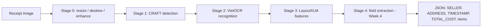

# QuetHoaDon

Vietnamese receipt understanding: read a receipt photo and extract structured information
(seller, address, timestamp, total, and item lines) with a **CRAFT → VietOCR → LayoutXLM** pipeline.

> **Status (Week 3 → 4).** Stages 0–3 (preprocessing, detection, OCR, LayoutXLM features) are implemented in
> `src/` and run through `notebooks/02_pipeline_colab.ipynb`. **Field extraction is not implemented yet and no
> model metrics have been measured.** Week 4 adds the baseline evaluation, the improved model and the error
> analysis - see [`reports/week4_plan.md`](reports/week4_plan.md).

## Pipeline



| Stage | Module | Status |
| --- | --- | --- |
| 0 Preprocessing | `src/preprocessing/image_preprocessor.py` | implemented, unit-tested |
| 1 Detection (CRAFT) | `src/detection/` | implemented; logic unit-tested, model call verified on Colab only |
| 2 OCR (VietOCR) | `src/recognition/` | implemented; logic unit-tested, model call verified on Colab only |
| 3 Features (LayoutXLM) | `src/features/` | implemented, not unit-tested end to end |
| 4 Field extraction | - | **not implemented** (Week 4) |
| Evaluation metrics | `src/evaluation/` | implemented, unit-tested; not yet run on real predictions |

Details: [`docs/architecture.md`](docs/architecture.md). Dataset facts and caveats: [`docs/dataset.md`](docs/dataset.md).

## Repository structure

```text
QuetHoaDon/
├── README.md
├── requirements.txt            # runtime (Colab/Kaggle GPU)
├── requirements-dev.txt        # light deps: enough to run all unit tests / CI
├── configs/
│   ├── config.yaml             # paths per environment, seed, data policy
│   ├── dataset.yaml            # MC-OCR files, annotated fields, split
│   └── model.yaml              # preprocessing / CRAFT / VietOCR / LayoutXLM parameters
├── docs/
│   ├── architecture.md         # pipeline, data contracts, model architecture, limits
│   └── dataset.md              # MC-OCR facts, split, data-use policy
├── notebooks/
│   ├── 01_mc_ocr_eda.ipynb     # dataset audit (run it and keep the outputs)
│   └── 02_pipeline_colab.ipynb # thin runner: install -> build pipeline -> smoke test -> full run
├── reports/
│   ├── week3_progress_report.md  # what is done / missing, repo audit, model assessment
│   └── week4_plan.md             # tasks, owners, metrics, deliverables for Week 4
├── scripts/
│   └── prepare_dataset.py      # manifests + invoice-level train/val/test split
├── src/
│   ├── common/                 # bbox utilities, config loader
│   ├── preprocessing/          # annotation_parser, dataset_preparer, image_preprocessor
│   ├── detection/              # interface, post-processing, CRAFT detector
│   ├── recognition/            # interface, OCR item, VietOCR recognizer
│   ├── features/               # LayoutXLM feature extractor
│   ├── extraction/             # output schema
│   ├── evaluation/             # CER/WER, detection P/R, field-level P/R/F1, amount normalisation
│   └── pipeline/               # ReceiptPipeline: batch run, resume, early stop
├── tests/                      # 60+ unit tests (no GPU needed)
└── .github/workflows/tests.yml # CI: runs the unit tests on every push / PR
```

## Quickstart

**Unit tests (laptop, no GPU):**

```bash
pip install -r requirements-dev.txt
python -m unittest discover -s tests -t . -v
```

**Dataset manifests and splits:**

```bash
python scripts/prepare_dataset.py --csv <dataset>/mcocr_train_df.csv \
    --images <dataset>/train_images/train_images --out outputs/dataset
```

**Run the pipeline (Colab, GPU):** open `notebooks/02_pipeline_colab.ipynb`, run the install cells, then the
*smoke test* (5 images) **before** the full run. The runner resumes after a disconnect and stops early if more
than half of the first images fail.

## Evaluation (what MC-OCR can and cannot measure)

MC-OCR annotates only `SELLER`, `ADDRESS`, `TIMESTAMP`, `TOTAL_COST`. Therefore:

- field-level P/R/F1 and exact match: the four annotated fields only;
- detection **recall** on annotated regions (precision is not measurable - unannotated text would count as false positives);
- CER/WER on regions matched to an annotation;
- `ITEM_NAME`, `ITEM_PRICE`, `QUANTITY` have no ground truth: qualitative evaluation only.

## Team

| # | Full name | Student ID |
| --- | --- | --- |
| 1 | Dam Huynh Hoai Nam | 24090022 |
| 2 | Cao Le Phuc Thinh | 24090024 |
| 3 | Dau Tuan Loc | 24090025 |
| 4 | Truong Dinh Nhien | 24090060 |
