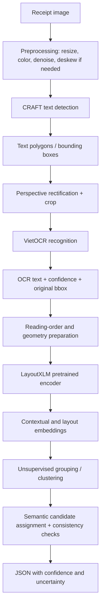

# System Architecture

## 1. Purpose

The system receives a photographed or scanned receipt and extracts merchant identity/location, purchased item names, item prices, and the receipt total. The project follows an inference-first, unsupervised extraction strategy: no receipt-specific entity labels are used to train a task-specific extraction head.

## 2. End-to-end flow

## 3. Stage responsibilities

### Stage 0 — Image preparation
Preserve the original image dimensions and coordinate frame. Apply only transformations needed for detection (for example, color conversion, resizing, or mild denoising). If the image is resized, retain scale factors so detected coordinates can be mapped back to the original image.

### Stage 1 — CRAFT text detection
CRAFT identifies character/text regions and returns polygons. Convert polygons into crop regions, but retain the quadrilateral and axis-aligned box in original-image coordinates. Detection confidence is a region-level signal and must not be confused with OCR confidence.

### Stage 2 — Rectification and VietOCR
Use a perspective transform for rotated or skewed quadrilateral regions. Pass each rectified crop to pretrained VietOCR. Store:
- recognized text;
- OCR confidence, if exposed by the chosen implementation;
- original polygon and bounding box;
- crop identifier and detection score.

If VietOCR does not expose a calibrated confidence for a selected decoder, store `null`; do not fabricate one.

### Stage 3 — LayoutXLM feature extraction
Normalize each box to the LayoutXLM coordinate range `[0, 1000]` using the original page width and height. Tokenize recognized text with the LayoutXLM tokenizer. For subword tokens, propagate the parent OCR region's bounding box. Run the pretrained LayoutXLM encoder and retain contextual hidden states.

In this project, LayoutXLM is a **feature extractor**, not a supervised BIO token classifier. Do not describe it as predicting `B-SELLER`, `I-SELLER`, or other entity tags unless a separately trained classification head is later introduced and the project scope is explicitly changed.

### Stage 4 — Unsupervised structure discovery
Build features for each OCR region from:
- LayoutXLM contextual representation;
- normalized position, width, height, and center;
- text shape (alphabetic, numeric, mixed);
- amount/date pattern indicators;
- alignment and distance to neighboring regions.

Use clustering or similarity grouping to discover repeated structural roles and line-item rows. Candidate grouping is followed by semantic interpretation rules. Cluster IDs have no inherent meaning: cluster `2` does not intrinsically mean `TOTAL_COST`.

### Stage 5 — Candidate interpretation and validation
Assign candidate roles using multiple signals, not position alone:
- seller: merchant-like text in the header, potentially supported by business-name cues;
- address/location: address-like text near merchant identity;
- item name: text region in a repeated product-row structure;
- item price: numeric/currency region aligned with an item row;
- total: amount candidate in the summary/footer region, preferably near total-related wording.

Check arithmetic where quantities and prices are available, compare candidate totals, and preserve alternative candidates when evidence conflicts. Return `uncertain` rather than silently selecting a weak candidate.

## 4. Data contracts

A text region should carry at least:
`region_id`, `polygon`, `bbox_xyxy`, `bbox_normalized`, `text`, `detection_score`, `ocr_confidence`, `reading_order`.

A final extracted field should carry:
`text`, `bbox`, `confidence` (only if meaningful scores are available), `status`, and optionally `alternatives`.

Line items should preserve associations between name, quantity, and price. A price must not be attached to an item solely because it is the nearest number if row alignment is ambiguous.

## 5. Unsupervised scope and limitations

- The upstream CRAFT, VietOCR, and LayoutXLM weights are pretrained; their original training may have used supervised data.
- This project does not fine-tune these models on MC-OCR entity labels.
- LayoutXLM embeddings plus clustering do not provide guaranteed semantic entity extraction. Candidate interpretation is a separate algorithmic layer.
- Receipt templates, languages, image quality, and OCR errors can change cluster behavior.
- MC-OCR annotations must remain isolated from the unsupervised inference path. They can be used for final evaluation only, with evaluation results reported separately.

## 6. Implementation status

Implemented: bounding-box geometry utilities, abstract detector/recognizer contracts, MC-OCR annotation parsing for audit, extraction schema, configuration, and unit tests.

Not established by the current repository alone: concrete CRAFT inference, VietOCR inference, perspective crop implementation, LayoutXLM feature extraction, unsupervised clustering, semantic assignment, end-to-end execution, or measured extraction performance.
