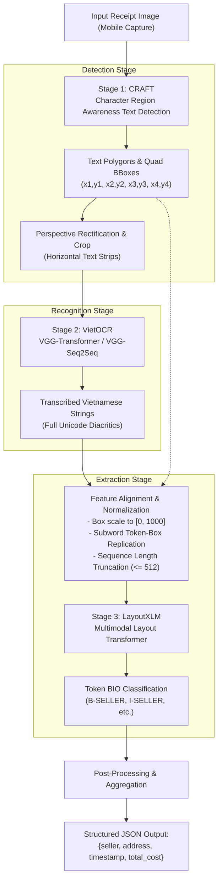

# System Architecture Specification

## 1. End-to-End Pipeline Overview

The system processes an input image of a Vietnamese receipt or invoice and produces structured key-value extractions. The pipeline is staged across three core deep learning models:

---

## 2. Model Responsibilities & Interfaces

### Stage 1: Text Detection — CRAFT
- **Model:** Character Region Awareness for Text Detection (CRAFT).
- **Responsibility:** Localize text instances across arbitrary document layouts, detecting characters and affinities between adjacent characters.
- **Input:** RGB receipt image `(H, W, 3)`.
- **Output:** Set of oriented 4-point bounding polygons:
  $$\mathcal{P} = \{[(x_1, y_1), (x_2, y_2), (x_3, y_3), (x_4, y_4)]_i\}_{i=1}^N$$
- **Pre-Processing for Stage 2:** Each polygon is transformed via an affine or perspective warp into an upright rectangular image strip of height 32px before transmission to VietOCR.

### Stage 2: Text Recognition — VietOCR
- **Model:** VietOCR (VGG Feature Extractor + Transformer / Seq2Seq Attention Decoder).
- **Responsibility:** Transcribe cropped horizontal image patches into grammatically valid Vietnamese strings preserving tone marks (sắc, huyền, hỏi, ngã, nặng) and vowel modifiers (ă, â, ê, ô, ơ, ư, đ).
- **Input:** Cropped image strip `(32, W_{crop}, 3)`.
- **Output:** UTF-8 text string $T_i$ corresponding to polygon $P_i$.

### Stage 3: Key Information Extraction — LayoutXLM
- **Model:** `microsoft/layoutxlm-base` (Multilingual Document Understanding Transformer).
- **Responsibility:** Jointly model text semantics, 2D spatial arrangement, and visual tokens to classify each token into target entity spans.
- **Input:**
  1. `input_ids`: Subword token indices produced by the XLM-RoBERTa SentencePiece tokenizer.
  2. `bbox`: 2D bounding boxes normalized to $[0, 1000]$ integer coordinates for every token: $[x_0, y_0, x_1, y_1]$.
  3. `attention_mask`: Attention mask for valid tokens vs padding.
- **Output:** Sequence of BIO entity tags (`B-SELLER`, `I-SELLER`, `B-ADDRESS`, `I-ADDRESS`, `B-TIMESTAMP`, `I-TIMESTAMP`, `B-TOTAL_COST`, `I-TOTAL_COST`, `O`).

---

## 3. Critical Technical Challenges & Design Decisions

### 3.1 Why LayoutXLM Instead of Vanilla LayoutLMv1?
- **Vanilla LayoutLMv1:** Built on `bert-base-uncased` WordPiece tokenizer. The English vocabulary lacks Vietnamese accent combinations. When tokenizing words like `"Phường Cẩm Sơn"` or `"Tổng tiền"`, the tokenizer produces massive rates of `[UNK]` tokens or splits single words into meaningless ASCII character fragments.
- **LayoutXLM:** Pre-trained on multilingual document corpora using SentencePiece (XLM-RoBERTa backbone). Vietnamese diacritics and subword morphology are natively preserved.

### 3.2 Bounding Box Normalization & Subword Alignment
1. **Coordinate Normalization:**
   Original image dimensions $(W, H)$ vary per mobile capture. Coordinates must be strictly scaled to integers in the range $[0, 1000]$:
   $$x_{norm} = \min\left(1000, \max\left(0, \text{int}\left(1000 \times \frac{x}{W}\right)\right)\right)$$
   $$y_{norm} = \min\left(1000, \max\left(0, \text{int}\left(1000 \times \frac{y}{H}\right)\right)\right)$$
   Constraint: $x_0 \le x_1$ and $y_0 \le y_1$.

2. **Subword Token Replication:**
   A single detected word (e.g., `"VinCommerce"`, bbox $[x_0, y_0, x_1, y_1]$) may tokenize into multiple subwords: `["_Vin", "Com", "merce"]`. Each subword token must inherit the spatial bounding box of the parent word.

3. **Special Token Handling:**
   Special tokens (`<s>`, `</s>`, `<pad>`) do not correspond to image text and must be assigned dummy coordinates `[0, 0, 0, 0]`.

### 3.3 Sequence Length Limits (512 Tokens)
- Long supermarket receipts contain detailed itemized lists, easily exceeding 512 subword tokens.
- Naive right-truncation loses the bottom third of the receipt—the exact location where `TOTAL_COST` and `TIMESTAMP` are almost universally positioned.
- **Strategy:** Sliding-window evaluation with 128-token overlap, or layout-guided spatial filtering that retains top and bottom document bands.

---

## 4. Current Limitations & Unresolved Technical Questions

> [!WARNING]
> End-to-end feasibility is a hypothesis currently being tested in Week 3 sprint tasks. It cannot be considered validated until the following questions are resolved via Kaggle experiments:

1. **OCR Error Propagation:** If VietOCR misrecognizes numerals or keywords (e.g., transcribing `"Tổng tiền"` as `"Tông tiên"`), does LayoutXLM still recognize the semantic role, or does attention fail?
2. **CRAFT Word vs Line Granularity:** VietOCR performs best on full line crops, whereas LayoutXLM performs best with word-level 2D bounding boxes. Bounding boxes must either be split geometrically into words or line-level boxes must be shared across tokens.
3. **Background Text Representation in Training:** The raw dataset `mcocr_train_df.csv` annotates only the 4 key entities. Training LayoutXLM with only positive key lines risks severe false-positive rates when deployed on full receipts with dozens of unannotated items.
