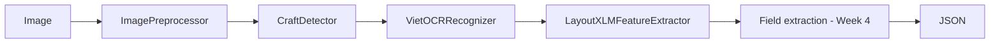

# System Architecture

## 1. Scope

Input: one receipt photo. Output: structured JSON.

| Field | Ground truth in MC-OCR | How it is evaluated |
| --- | --- | --- |
| `SELLER`, `ADDRESS`, `TIMESTAMP`, `TOTAL_COST` | yes | field-level P/R/F1, exact match |
| `ITEM_NAME`, `ITEM_PRICE`, `QUANTITY` | **no** | qualitative only (sampled receipts) |

## 2. Pipeline

| Stage | Class (module) | Input -> output | Key parameters (`configs/model.yaml`) |
| --- | --- | --- | --- |
| 0 | `ImagePreprocessor` (`src/preprocessing/image_preprocessor.py`) | path -> resized / deskewed / enhanced BGR image, scale, skew angle | `target_max_dim=1280`, `enhance`, `max_skew=15` |
| 1 | `CraftDetector` (`src/detection/craft_detector.py`) | image -> `TextRegion` list in reading order | `text_threshold=0.7`, `link_threshold=0.4`, `low_text=0.4`, `long_size=1280` |
| 2 | `VietOCRRecognizer` (`src/recognition/vietocr_recognizer.py`) | regions -> `OcrItem` list (text + confidence) | `vgg_transformer`, `batch_size=32` |
| 3 | `LayoutXLMFeatureExtractor` (`src/features/layoutxlm_extractor.py`) | OCR items + image -> hidden states `[1, 512, 768]` (+ visual tokens) | `max_seq_length=512`, fp16 storage |
| 4 | not implemented | OCR items (+ features) -> fields | see section 5 |

`ReceiptPipeline` (`src/pipeline/runner.py`) runs stages 0-3 over many images, writes `<id>.json` and `<id>.pt`,
records per-stage timing, resumes after interruptions and stops early on systematic failures.

### Stage notes

- **Preprocessing.** Deskew uses a projection-profile search over ±15° and only rotates when the gain over 0° is
  clear. After a rotation, `orig_bbox` (resize-only mapping) is no longer exact; use `bbox` on the processed image.
- **CRAFT.** `craft-text-detector` breaks on modern NumPy when it returns polygons with different point counts
  (`inhomogeneous shape`). `patch_craft_library()` forces 4-point boxes. `drop_nested()` removes the separate tiny
  boxes CRAFT emits for the comma/dot inside amounts such as `27,000`, which otherwise become OCR garbage.
- **Reading order.** Regions are grouped into lines by centre-y (tolerance = 0.5 × median height), then sorted left to right.
- **VietOCR.** Batch inference with a per-crop fallback. `ocr_confidence` is VietOCR's sequence probability;
  CRAFT in this library exposes no per-box score, so `detection_score` is `null`.
- **LayoutXLM.** Words inherit a slice of their OCR region's box, proportional to word length; boxes are normalised
  to [0, 1000]. Sequences longer than 512 tokens are truncated (`possibly_truncated` flag in the JSON).

## 3. Conventions and data contracts

- Internal box format is **`xyxy`**. MC-OCR annotations are `xywh`; convert with `xywh_to_xyxy` before computing IoU.
- OCR JSON (`<id>.json`): `file_id`, `orig_shape`, `processed_shape`, `scale_factor`, `skew_angle`, `n_detected`,
  `n_text_regions`, `possibly_truncated`, `timing_sec`, `ocr_items[]` with
  `region_id`, `reading_order`, `polygon`, `bbox`, `orig_bbox`, `text`, `ocr_confidence`, `detection_score`.
- Features (`<id>.pt`): `last_hidden_state`, `input_ids`, `normalized_bboxes`, `attention_mask`, `words`, `file_id`.
- Final field: `text`, `bbox`, `confidence` (only if meaningful), `status` in {`found`, `uncertain`, `not_found`}.

## 4. Model architecture: LayoutXLM

LayoutXLM-base is a multilingual document Transformer: an XLM-RoBERTa-style text encoder (12 layers, hidden size
768) whose input embeddings add 2D position embeddings (x0, y0, x1, y1, width, height from the [0, 1000] box) and
whose self-attention uses spatial-aware biases; image patches from a CNN backbone are appended as visual tokens.
The team decided to **fine-tune** it (supervised). `LayoutLMv2ForTokenClassification` loaded from
`microsoft/layoutxlm-base` adds a linear token-classification head over the text positions (`768 -> 9`: `O` plus
`B-`/`I-` tags for the four annotated fields) and trains the whole encoder with cross-entropy loss. A frozen-encoder
variant (M1a, head only) is kept as an ablation. See `reports/project_plan.md` for the full list of models and experiments.

## 5. Field extraction

- **Baseline B0 (Week-3 pipeline, no gradient training).** Frozen LayoutXLM features are clustered (the number of
  clusters is chosen by Silhouette score on validation) and each cluster is mapped to a field by majority vote on the
  development (train) split, because cluster ids carry no meaning on their own. Keyword and format rules refine the
  result: `TOTAL_COST` amount near total-related keywords in the lower part of the receipt, `TIMESTAMP` date/time
  regex, `SELLER` header text, `ADDRESS` address-like text near the seller. Return alternatives and `uncertain` when
  evidence conflicts.
- **Improved (fine-tuned token classifier).** Labels come from mapping each annotated polygon onto the processed image
  and giving a word the label of the polygon that contains most of its box (`src/preprocessing/token_dataset.py`);
  words outside the four fields are `O`. Consecutive words with the same field form one entity (`B-` then `I-`).
  `src/extraction/decode.py` turns predicted tags back into field values (the amount of `TOTAL_COST` is taken from the
  numeric words of the entity).

## 6. Limitations

- OCR errors propagate to every later stage (detection → OCR → extraction).
- A receipt contains subtotal, tax, cash, change and total: the largest number is not automatically the total.
- Item names and prices can wrap across lines or columns.
- VietOCR is Vietnamese-only; other languages need a different recogniser.
- MC-OCR is biased toward chain stores and legible printed receipts.
