# Project Handover — Unsupervised Receipt Extraction

## 1. Project goal

Build a system that reads a receipt image and extracts:
- seller/merchant name;
- seller address or location;
- names of purchased items;
- price of each item;
- final total amount.

Optional quantity and transaction timestamp can be retained when detected reliably.

## 2. Agreed pipeline

```mermaid
flowchart LR
    A["Receipt image"] --> B["CRAFT text detection"]
    B --> C["Polygon crop / perspective rectification"]
    C --> D["VietOCR recognition"]
    D --> E["OCR strings + 2D boxes"]
    E --> F["LayoutXLM pretrained representations"]
    F --> G["Unsupervised clustering and structural grouping"]
    G --> H["Semantic candidate assignment"]
    H --> I["Validated JSON output"]
```

### CRAFT
Use pretrained CRAFT to detect text regions in 2D image space. Keep quadrilateral polygons, axis-aligned boxes, and detection scores.

### VietOCR
Crop/rectify each detected text region and run pretrained VietOCR. Keep recognized text associated with the original image coordinates. Detection and OCR confidence are separate signals.

### LayoutXLM
Feed OCR text and normalized boxes to the pretrained LayoutXLM encoder. Use hidden representations as features for similarity, grouping, and layout-context analysis. Do not describe LayoutXLM as outputting entity labels unless a task-specific classification head has actually been trained.

### Unsupervised extraction layer
Cluster or group text regions by contextual embeddings, geometry, alignment, text patterns, and neighboring regions. Then interpret candidate groups:
- header/business-like text as possible seller;
- address-like text near seller as possible location;
- repeated rows as possible item records;
- text regions in item rows as possible item names;
- aligned numeric/currency regions as possible item prices;
- summary/footer amounts near total-related wording as possible receipt total.

A cluster identifier has no semantic meaning by itself. Use consistency checks and return alternatives/uncertainty when the evidence is insufficient.

## 3. What “unsupervised” means here

The project does not use MC-OCR receipt entity labels to train or fine-tune its extraction model. CRAFT, VietOCR, and LayoutXLM are pretrained upstream models; their original training may have been supervised. Their use as pretrained inference/feature-extraction components does not make the project-specific extraction training supervised.

MC-OCR annotations are reserved for dataset audit and final evaluation. They must not be passed into the inference pipeline or used to tune thresholds if the experiment is claimed to be unsupervised.

## 4. Current code inventory

- `src/common/bbox_utils.py`: geometric conversion and normalization.
- `src/detection/detector.py`: abstract detector interface and result structure; no concrete CRAFT loader.
- `src/recognition/recognizer.py`: abstract recognizer interface and result structure; no concrete VietOCR loader.
- `src/preprocessing/annotation_parser.py`: MC-OCR annotation parser for audit/evaluation only.
- `src/extraction/schema.py`: canonical output field names.
- `configs/`: runtime, dataset, and pretrained model configuration.
- `tests/`: unit tests for geometry, annotation parsing, and output schema.

## 5. Remaining implementation tasks

1. Implement and test a concrete CRAFT inference adapter.
2. Implement polygon perspective rectification and crop generation.
3. Implement a VietOCR inference adapter and persist text-to-box associations.
4. Implement LayoutXLM tokenizer/encoder inference with subword-to-box alignment.
5. Implement unsupervised region features, clustering, and row/column grouping.
6. Implement semantic candidate assignment and item-name/price association.
7. Implement arithmetic and spatial consistency checks.
8. Export JSON with confidence/uncertainty and preserve source bounding boxes.
9. Evaluate the frozen pipeline on held-out annotations without using them for training or tuning.

## 6. Risks and limitations

- LayoutXLM embeddings do not intrinsically identify semantic fields.
- OCR errors can propagate to layout and semantic interpretation.
- Item names and prices may wrap across lines or use multiple columns.
- A receipt can contain subtotal, tax, cash received, change, and total; the largest or lowest number is not automatically the total.
- OCR confidence may not be calibrated or exposed by the selected implementation.
- Performance on one language or dataset does not establish cross-language performance.

## 7. Expected prediction structure

Each extracted value should retain text, source box, optional confidence, and a status such as `found`, `uncertain`, or `not_found`. Item records should preserve the association among name, quantity, and price.
