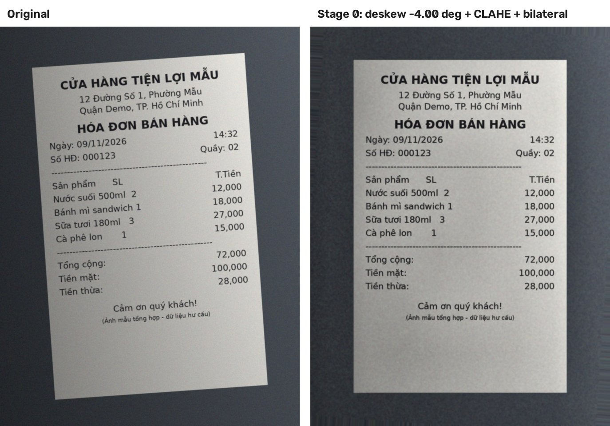

# Dataset: MC-OCR 2021

Source: Kaggle `domixi1989/vietnamese-receipts-mc-ocr-2021`. Vietnamese retail receipts photographed with phones
(skew, shadows, wrinkles, faded thermal print).

## Annotations

`mcocr_train_df.csv`: one row per image with `img_id`, `anno_image_quality`, `anno_num`, `anno_texts`,
`anno_labels`, `anno_polygons` (`|||`-separated texts/labels; polygons carry `bbox` in **xywh**, `segmentation`, `category_id`).

| Label | category_id | Note |
| --- | --- | --- |
| `SELLER` | 15 | |
| `ADDRESS` | 16 | often several regions per receipt |
| `TIMESTAMP` | 17 | |
| `TOTAL_COST` | 18 | raw data contains the typo `TOTAL_TOTAL_COST`, normalised by the parser |

**Only these four fields are annotated, and only the regions that belong to them.** There is no ground truth for
`ITEM_NAME`, `ITEM_PRICE`, `QUANTITY`, and unannotated text (item lines, tax, change) is not boxed.

## Prepared split (`scripts/prepare_dataset.py`)

Figures reported in the project plan from the Kaggle run - **re-verify with the script in your environment**:

| Quantity | Value |
| --- | --- |
| records in CSV / valid invoices used | 1155 / 1153 |
| empty / invalid / missing-image records | 1 / 1 / 0 |
| annotated regions | 6585 |
| invoices train / validation / test | 922 / 115 / 116 (80 / 10 / 10, seed 42) |
| regions train / validation / test | 5308 / 643 / 634 |

The plan's `label_distribution` lists only `ADDRESS` (1880) and `SELLER` (1153), which sums to 3033, not 6585:
`TIMESTAMP` and `TOTAL_COST` counts are missing from that excerpt. Rerun the script and record all four.

## Preprocessing steps

| Step | Code | Input -> output |
| --- | --- | --- |
| 1. Parse and clean annotations | `src/preprocessing/annotation_parser.py` | CSV row -> texts, labels, `xywh` polygons; normalises `TOTAL_TOTAL_COST`, drops empty / invalid records |
| 2. Manifests + invoice-level split | `scripts/prepare_dataset.py` (`src/preprocessing/dataset_preparer.py`) | CSV + images -> `mcocr_manifest_split.csv`, `dataset_summary.json` |
| 3. Image preprocessing (Stage 0) | `src/preprocessing/image_preprocessor.py` | photo -> resized (longest side 1280), deskewed, CLAHE + bilateral-filtered image |
| 4. OCR run (Stages 1-2) | `notebooks/02_pipeline_colab.ipynb` | images -> `<id>.json` with OCR words and boxes |
| 5. BIO token dataset | `scripts/build_token_dataset.py` (`src/preprocessing/token_dataset.py`) | OCR JSON + annotations -> `train/validation/test.jsonl` (words, boxes normalised to [0, 1000], BIO tags) + label-coverage report |

Stage 0 on the bundled sample (`assets/samples/sample_receipt.jpg`, synthetic): the 4° tilt is removed and contrast
is equalised before detection.

## Known issues

- **Image count mismatch.** The Colab notebook found 1044 images (path filter `data0.7`) while 1153 invoices are
  valid. Find out which ~109 are missing before evaluating on the test split.
- **Leakage check covers `img_id` only.** The plan itself flags the risk of one receipt photographed 2-3 times and
  split across train/test; near-duplicate detection (perceptual hash) is not implemented.
- **Manifests store absolute `image_path`s** (e.g. `/kaggle/input/...`), which break on another machine; store paths relative to the dataset root.
- **Quality.** `anno_image_quality` is parsed but not yet used to stratify the analysis.

## Data-use policy

The team decided (Nov 2026) that the extraction model is **supervised**. MC-OCR entity labels are used as follows:

- **train** split: fit the models (fine-tuned LayoutXLM, the category classifier);
- **validation** split: choose hyper-parameters, post-processing rules and the checkpoint;
- **test** split: scored **once**, after every configuration is frozen;
- inference never reads annotations.

A fine-tuned model is never called "unsupervised" in the report. The Week-3 baseline (B0: frozen LayoutXLM features,
clustering, rules) has no gradient training; the development (train) split tunes its clustering configuration and the
cluster-to-field mapping, and the validation split selects its parameters.

## Other datasets

SROIE 2019 (English) and CORD (Indonesian) are only candidates: no files, no adapters, no results. Mention them as
future work; VietOCR would not transfer to them without a language-appropriate recogniser.
