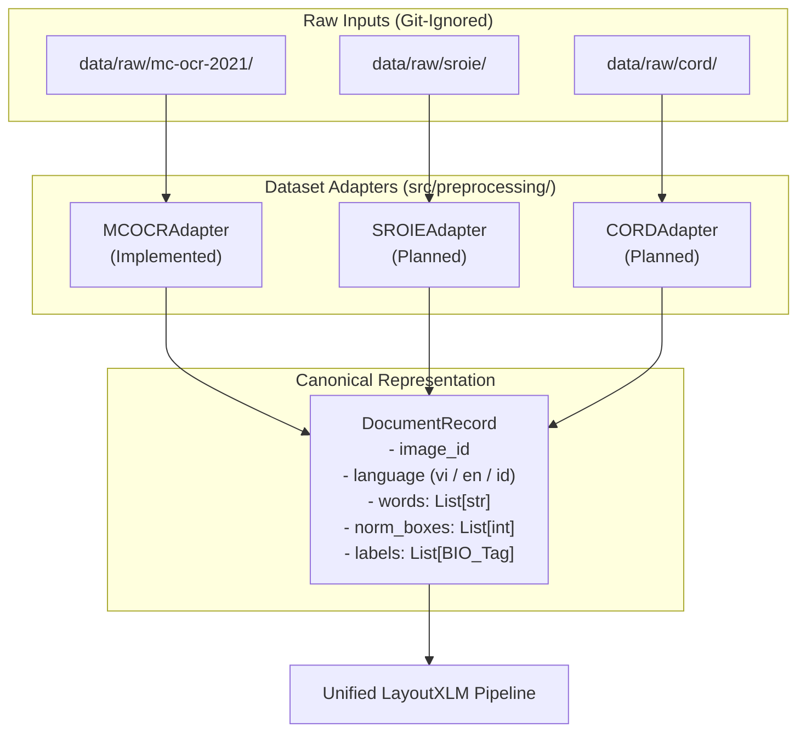

# Multi-Dataset Architecture & Integration Strategy

## 1. Overview & Dataset Isolation Principle

The `ai-invoice-intelligence` system is designed to support multi-lingual invoice intelligence across three distinct benchmark datasets:

1. **MC-OCR 2021** (Vietnamese Receipts) — **Primary Dataset**
2. **SROIE 2019** (English / Malaysian Receipts) — **Planned Integration**
3. **CORD 2019** (Indonesian Receipts) — **Planned Integration**

### Core Architectural Principle: Strict Isolation
- **No Merged Raw Data:** Datasets must reside in isolated directories under `data/raw/<dataset-key>/`.
- **Preserve Ground-Truth Annotations:** Original annotation formats (CSV, nested JSON, coordinate text files) are preserved in their native structures.
- **Independent Adapters:** Each dataset is parsed through a dedicated adapter that converts native annotations into a canonical intermediate representation.
- **No Combined Training Sets Yet:** Cross-dataset training or zero-shot transfer will only be conducted after independent per-dataset baselines are established and validated.

---

## 2. Directory Layout (All Git-Ignored)

```text
data/
├── raw/
│   ├── mc-ocr-2021/              # Vietnamese (Primary)
│   │   ├── mcocr_train_df.csv
│   │   ├── train_images/
│   │   └── val_images/
│   ├── sroie/                    # English (Planned)
│   │   ├── task1_task2_text/
│   │   └── task3_entities/
│   └── cord/                     # Indonesian (Planned)
│       ├── train/
│       ├── dev/
│       └── test/
└── processed/
    ├── mc-ocr-2021/
    ├── sroie/
    └── cord/
```

> [!IMPORTANT]
> The root `.gitignore` excludes the entire `data/` directory. No image files, raw CSVs, or JSON annotations will ever be committed to Git.

---

## 3. Dataset Characteristics & Schema Comparison

| Dimension | MC-OCR 2021 | SROIE 2019 | CORD 2019 |
| :--- | :--- | :--- | :--- |
| **Language** | Vietnamese (Latin + Tonal Diacritics) | English (Malaysian Latin, no accents) | Indonesian (Bahasa Indonesia Latin) |
| **Document Domain** | Mobile-captured retail & food receipts | Scanned receipt images | Mobile-captured Indonesian receipts |
| **Native Format** | Single CSV (`mcocr_train_df.csv`) with `anno_polygons`, `anno_texts`, `anno_labels` | Per-image `.txt` (box + text) + per-image `.json` (4 key entities) | Per-image JSON with hierarchical lines, words, quad-boxes, and fine-grained labels |
| **Native Entities** | `SELLER`, `ADDRESS`, `TIMESTAMP`, `TOTAL_COST` | `company`, `address`, `date`, `total` | 30 fine-grained sub-labels under `menu`, `sub_total`, `total`, `void_menu` |
| **Coordinate System** | Quadrilateral polygons & COCO `[x, y, w, h]` in image pixels | 8-point polygons `[x1, y1, x2, y2, x3, y3, x4, y4]` | 4-point quadrilateral bounding boxes `[x1, y1, x2, y2, x3, y3, x4, y4]` |
| **Primary OCR Engine** | **VietOCR** (tuned for Vietnamese accents) | Tesseract / EasyOCR / TrOCR | PaddleOCR / Tesseract / EasyOCR |

---

## 4. Canonical Entity Schema Mapping

To prevent semantic conflation, a unified canonical schema is defined **strictly for entities that share true semantic identity**:

| Canonical Entity | MC-OCR 2021 | SROIE 2019 | CORD 2019 | Semantic Compatibility Notes |
| :--- | :--- | :--- | :--- | :--- |
| **`SELLER`** | `SELLER` | `company` | *Not directly supported* | Full match between MC-OCR and SROIE. In CORD, merchant name is typically in header metadata or unsegmented. |
| **`ADDRESS`** | `ADDRESS` | `address` | *Not directly supported* | Full match between MC-OCR and SROIE. CORD does not standardize merchant address spans. |
| **`TIMESTAMP`** | `TIMESTAMP` | `date` (partial) | *Not directly supported* | MC-OCR contains full timestamp (date + time). SROIE contains date only. |
| **`TOTAL_COST`** | `TOTAL_COST` | `total` | `total.total_price` / `total.cashprice` | **Universal across all three datasets.** Refers to the final payable amount. |

### Schema Incompatibilities & Boundary Rules
1. **Never force CORD into 4-class extraction prematurely:** CORD is inherently a menu/line-item and hierarchical subtotal dataset. Forcing it into `SELLER` / `ADDRESS` would introduce false-negative training signals.
2. **Handle Time vs Date:** When evaluating SROIE, the canonical `TIMESTAMP` field operates in date-only mode.

---

## 5. OCR & Language Compatibility Analysis

### The OCR Engine Divide
- **VietOCR:** Specifically engineered with an attention-based sequence-to-sequence / transformer decoder trained on Vietnamese vocabulary. 
  - *Risk with English/Indonesian:* Applying VietOCR to SROIE or CORD will produce tone mark hallucinations (e.g. converting "TOTAL" to a phonetically closest accented Vietnamese syllable).
  - *Solution:* Keep OCR modules modularized. MC-OCR uses `VietOCRRecognizer`; SROIE and CORD will utilize Latin OCR engines (e.g. PaddleOCR / TrOCR) or use provided ground-truth OCR boxes.

### LayoutXLM as the Unified Extraction Backbone
- `microsoft/layoutxlm-base` was pre-trained on 53 languages (including Vietnamese, English, and Indonesian) using XLM-RoBERTa.
- Because LayoutXLM accepts language-agnostic 2D coordinates $[0, 1000]$ and subword tokens, it can serve as the **single unified neural architecture** for all three datasets, with dataset-specific classification heads or language adapters.

---

## 6. Adapter Architecture Pattern



Each adapter will inherit from an abstract `BaseAnnotationAdapter` interface, enforcing a contract:
```python
class BaseAnnotationAdapter(ABC):

  @abstractmethod
  def parse_sample(self, raw_entry: Any) -> CanonicalDocumentRecord:
    pass

  @abstractmethod
  def get_dataset_metadata(self) -> DatasetMetadata:
    pass
```

---

## 7. Next Actions for Multi-Dataset Support

1. Maintain MC-OCR 2021 as the active, single source of truth for Week 3 and Week 4 baselines.
2. In subsequent phases, add SROIE adapter to benchmark English invoice parsing.
3. In subsequent phases, add CORD adapter to benchmark Indonesian hierarchical receipt extraction.
