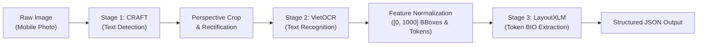
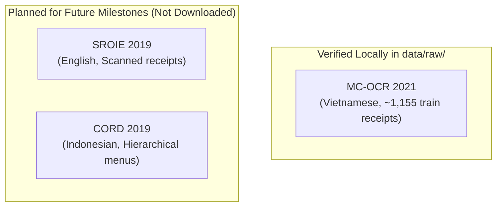
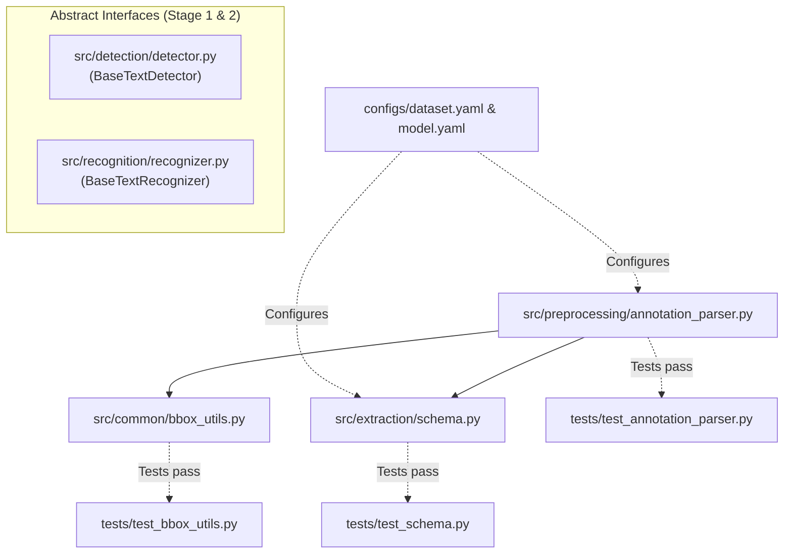
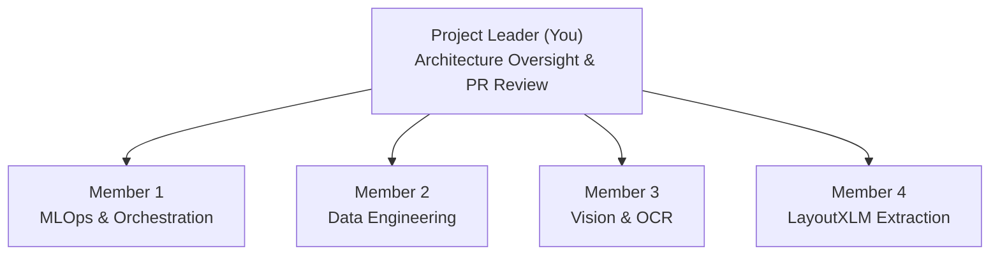

# Project Leader Handover: Technical Understanding & Implementation Report

**Project:** AI Invoice Intelligence (`ai-invoice-intelligence`)  
**Target Milestone:** Week 3 Handover / Week 4 Sprint Launch  
**Role:** Senior ML Engineer onboarding the Project Leader  
**Primary Repository:** `https://github.com/kitalikedev/ai-invoice-intelligence.git`  
**Integration Branch:** `main`

---

## Executive Summary

Welcome aboard as the Project Leader for **AI Invoice Intelligence**. This document serves as your complete technical briefing on the true, current state of the repository. 

Our goal is not to present an idealized pitch, but to give you an exact, evidence-based inventory of:
1. What is **fully implemented and tested**.
2. What is **implemented as base abstractions but untested**.
3. What is **architecturally designed but not yet coded**.
4. What is **planned for future milestones**.

As Project Leader, you inherit a repository with clean Git governance, zero credential/data leakage, verified geometric utilities, a validated MC-OCR annotation parser, and complete architectural documentation. Model training and GPU inference have deliberately **not** been started yet to keep local development lightweight and prevent unvalidated assumptions from contaminating our codebase.

---

## Section 1 — Project Overview

### 1.1 The Problem Being Solved
Extracting structured business information from invoices and receipts is a critical bottleneck in finance, accounting, and supply chain automation. In Vietnam and Southeast Asia, a vast proportion of transaction receipts are issued as thermal paper slips, mobile photos, or unstructured physical invoices.

These documents exhibit extreme real-world challenges:
- **Optical Degradation:** Non-uniform lighting, shadows, camera blurs, crumpled paper, faded thermal ink, and severe perspective skew.
- **Linguistic Complexity:** Vietnamese is a Latin script with 5 tonal marks and extensive vowel modifiers (ă, â, đ, ê, ô, ơ, ư). Missing a single accent completely alters word semantics.
- **Layout Heterogeneity:** Every merchant or point-of-sale (POS) vendor uses a distinct template, table structure, font hierarchy, and receipt length.

### 1.2 Input and Expected Output
- **System Input:** An arbitrary-resolution mobile photograph or scanned image of an invoice/receipt in standard image format (`.jpg`, `.png`).
- **Expected Output:** A structured JSON object containing verified, key business entities with bounding box coordinates and extraction confidence:
  ```json
  {
    "seller": "CÔNG TY TNHH MINIMART ANAN",
    "address": "Chợ Sủi, Xã Phú Thị, Huyện Gia Lâm, Hà Nội",
    "timestamp": "11/08/2020 08:06",
    "total_cost": "74,000",
    "currency": "VND",
    "confidence_scores": {
      "seller": 0.96,
      "address": 0.92,
      "timestamp": 0.98,
      "total_cost": 0.95
    }
  }
  ```

### 1.3 Project Scope and Boundary Limitations
- **Current Core Scope:** The 4 target entities standardized in the MC-OCR 2021 challenge: `SELLER`, `ADDRESS`, `TIMESTAMP`, and `TOTAL_COST`.
- **Out of Current Scope:** Full itemized line-item extraction (individual SKU names, line-item quantities, unit prices).
- **Compute Boundaries:** Local machines are strictly for lightweight orchestration, unit testing, and code development. Heavy GPU workloads (CRAFT text detection, VietOCR recognition, LayoutXLM fine-tuning) are restricted to **Kaggle Notebooks** (using free P100 / T4 GPU quotas).

### 1.4 Why This Problem Requires Deep Learning
Traditional approaches (heuristic rule-based coordinate templates, anchor-word regular expressions, morphological image processing) fail completely because:
1. **Template Brittleness:** Regex patterns like `"Tổng cộng: ([0-9,.]+)"` fail when OCR misrecognizes diacritics, when lines wrap, or when the layout uses two-column spatial alignment where the key and value are separated by large whitespace gaps.
2. **Spatial-Visual-Semantic Interaction:** A monetary figure like `"50,000"` might represent a subtotal, item price, VAT amount, customer cash tendered, or the change due. Determining that it is the `TOTAL_COST` requires **multimodal context**: reading the text semantics, understanding its 2D spatial position (typically at the bottom right), and analyzing visual visual cues (bold typeface, separating horizontal divider lines). Multimodal Layout Transformers (LayoutXLM) solve this by learning joint representations over text, 2D coordinates, and document visual features.

---

## Section 2 — Architecture Walkthrough

The end-to-end extraction pipeline follows a three-stage modular architecture:



### Component Breakdown & Implementation Status Matrix

| Component | Responsibility | Input $\to$ Output | Why Needed | Implementation Status | Known Limitations |
| :--- | :--- | :--- | :--- | :--- | :--- |
| **Stage 1: CRAFT** | Detects arbitrary-oriented character regions and text bounds | Image `(H, W, 3)` $\to$ Polygons `[[[x1,y1]..[x4,y4]], ...]` | Finds text regions without requiring rectangular horizontal alignment | **Implemented as base abstract class; concrete PyTorch loader designed but not yet implemented** | High memory footprint; outputs oriented polygons that require rectification before OCR |
| **Image Rectification** | Warps perspective and crops text lines | Image + 4-pt polygon $\to$ Upright image strip `(32, W_crop, 3)` | VietOCR cannot read rotated, curved, or tilted text strips | **Designed but not yet implemented** | Extreme camera angles or fold creases can distort aspect ratios |
| **Stage 2: VietOCR** | Sequence-to-sequence text transcription | Upright image strip $\to$ Vietnamese string with tone marks | Decodes Vietnamese diacritics natively using VGG + Transformer | **Implemented as base abstract class; concrete inference wrapper designed but not yet implemented** | Sensitive to vertical text; hallucinates tone marks if fed English/Indonesian text |
| **Feature Normalizer** | Scales boxes to $[0, 1000]$, replicates subwords | Bboxes + Words $\to$ `input_ids`, `bbox`, `attention_mask` | Formats spatial and semantic tokens to LayoutXLM's required input contract | **Implemented and tested** (`src/common/bbox_utils.py`) | Sequence length is capped at 512 tokens; documents exceeding 512 tokens require windowing |
| **Stage 3: LayoutXLM** | Token classification into BIO spans | Multimodal tensors $\to$ Token labels (`B-SELLER`, `I-SELLER`, etc.) | Contextually classifies text spans based on joint 2D layout and text semantics | **Schema and mappings implemented and tested; training pipeline designed** | Subword token boundary alignment requires exact heuristic span matching |
| **Post-Processor** | Aggregates token spans into final entity strings | BIO labeled tokens $\to$ JSON entity dictionary | Resolves multiple candidates, normalizes dates and currency | **Designed but not yet implemented** | Ambiguity resolution when multiple candidate totals appear |

### Status Categorization Key
1. **Implemented and Tested:** Code exists in `src/`, covered by unit tests in `tests/`, verified against raw data.
2. **Implemented but Untested:** Base abstraction or skeleton code exists in `src/`, but lacks concrete mock/unit test coverage.
3. **Designed but Not Implemented:** Formal architecture, math, and interfaces specified in `docs/` and `configs/`, but code is not yet written.
4. **Planned for Future Phases:** Forward-looking integrations (SROIE, CORD, multi-lingual zero-shot transfer).

---

## Section 3 — Dataset Analysis

We maintain a strict **isolation policy** between datasets. Do not assume all datasets are available or formatted identically.



### 3.1 MC-OCR 2021 (Primary Dataset — Verified Locally)
- **Language:** Vietnamese (Latin script with full diacritics).
- **Physical Availability:** Confirmed available locally under `data/raw/` (and symlinked to `data/raw/mc-ocr-2021/`).
- **Actual Scale:** Exactly 1,155 images in `train_images/train_images/` and 391 images in `val_images/val_images/`.
- **Annotation Format:** Single CSV (`mcocr_train_df.csv`) containing `img_id`, `anno_polygons` (JSON string of dicts with COCO bboxes and polygon segmentations), `anno_texts` (delimited by `|||`), `anno_labels` (delimited by `|||`), and `anno_image_quality`.
- **Entity Labels:** `SELLER`, `ADDRESS`, `TIMESTAMP`, `TOTAL_COST`.
- **Verified Anomalies:**
  - Row 8 has a typo: `TOTAL_TOTAL_COST`. Our parser automatically normalizes this to `TOTAL_COST`.
  - Rows 1011 and 1091 have 0 annotations (`anno_num = 0`). Our parser handles these without crashing.
- **Role in Project:** Primary dataset for Week 3 and Week 4 model training and baseline benchmarking.

### 3.2 SROIE 2019 (English — Planned, Not Downloaded)
- **Language:** English (Malaysian Latin, no tone marks).
- **Physical Availability:** **Not downloaded**. Directory `data/raw/sroie/` is currently an empty placeholder.
- **Annotation Format:** Two separate files per receipt:
  1. `.txt` file containing bounding box coordinates and raw OCR text lines (`x1, y1, x2, y2, x3, y3, x4, y4, text`).
  2. `.json` file containing the 4 ground-truth key-value targets (`company`, `address`, `date`, `total`).
- **Entity Labels:** `company`, `address`, `date`, `total`.
- **Compatibility with Canonical Schema:**
  - `company` $\leftrightarrow$ `SELLER` (Full match).
  - `address` $\leftrightarrow$ `ADDRESS` (Full match).
  - `date` $\leftrightarrow$ `TIMESTAMP` (Partial match: SROIE provides date only, whereas MC-OCR often includes time).
  - `total` $\leftrightarrow$ `TOTAL_COST` (Full match).
- **OCR Engine Consideration:** SROIE cannot use VietOCR; it must use an English OCR engine (Tesseract, PaddleOCR, or TrOCR) or use its provided ground-truth text boxes.
- **Role in Project:** Secondary benchmark to validate English language transfer on the same LayoutXLM backbone.

### 3.3 CORD 2019 (Indonesian — Planned, Not Downloaded)
- **Language:** Indonesian (Bahasa Indonesia).
- **Physical Availability:** **Not downloaded**. Directory `data/raw/cord/` is currently an empty placeholder.
- **Annotation Format:** Deeply nested JSON per receipt detailing word-level quad-boxes, line group IDs, and hierarchical labels.
- **Entity Labels:** 30 fine-grained sub-labels organized under 4 super-labels: `menu`, `sub_total`, `total`, `void_menu`.
- **Compatibility Issues:**
  - CORD does **not** standardize merchant name (`SELLER`) or merchant `ADDRESS` as primary extraction classes.
  - `TOTAL_COST` is compatible (`total.total_price` or `total.cashprice`).
  - **Critical Rule:** Never force CORD into our 4-class schema. Doing so would treat missing `SELLER` and `ADDRESS` tokens as background (`O`), polluting the model with false-negative supervisory signals.
- **Role in Project:** Long-term research expansion for hierarchical and fine-grained line-item receipt understanding.

---

## Section 4 — Codebase Walkthrough

Here is the exact structural inventory of the repository and how components connect.

```text
ai-invoice-intelligence/
├── configs/
│   ├── config.yaml                    # Runtime environment, logging, and I/O paths
│   ├── dataset.yaml                   # Multi-dataset config, label schemas, and split ratios
│   └── model.yaml                     # Model hyperparameters for CRAFT, VietOCR, LayoutXLM
├── docs/
│   ├── architecture.md                # 3-stage model pipeline & tokenizer analysis
│   ├── dataset_documentation.md       # MC-OCR 2021 schema, access & licensing
│   ├── multi_dataset_architecture.md  # Multi-dataset isolation & adapter strategy
│   └── preprocessing.md               # Normalization, BIO tagging & leakage prevention
├── notebooks/kaggle/
│   └── 01_mc_ocr_eda.ipynb            # Dynamic dataset exploration & quality report generator
├── src/
│   ├── common/
│   │   ├── __init__.py
│   │   └── bbox_utils.py              # Geometric transformations, [0, 1000] scaling, IoU
│   ├── detection/
│   │   ├── __init__.py
│   │   └── detector.py                # Abstract BaseTextDetector & TextDetectionResult
│   ├── recognition/
│   │   ├── __init__.py
│   │   └── recognizer.py              # Abstract BaseTextRecognizer & TextRecognitionResult
│   ├── extraction/
│   │   ├── __init__.py
│   │   └── schema.py                  # TargetEntity enum, 9-class BIO schema, LABEL2ID mapping
│   └── preprocessing/
│       ├── __init__.py
│       └── annotation_parser.py       # Robust CSV deserializer & anomaly corrector
├── tests/
│   ├── __init__.py
│   ├── test_annotation_parser.py      # Unit tests for CSV parsing, anomalies, empty rows
│   ├── test_bbox_utils.py             # Unit tests for geometry, scaling, clamping, IoU
│   └── test_schema.py                 # Unit tests for BIO cardinality and label mappings
├── reports/
│   ├── week3_progress_report.md       # Week 3 milestone report
│   └── project_leader_handover.md     # This document
├── .github/
│   └── CODEOWNERS                     # Assigns ownership to @kitalikedev
├── .gitignore                         # Comprehensive data, weight, and secret exclusion
├── README.md                          # Quickstart, workflow, branch and PR conventions
└── requirements.txt                   # Pinned core dependencies
```

### Module Interactions & Data Flow



### File-by-File Technical Audit

1. **`src/common/bbox_utils.py` (Implemented & Tested):**
   - `polygon_to_bbox(segmentation)`: Handles both flat `[x1, y1, ...]` and nested `[[x1, y1, ...]]` polygons to produce axis-aligned `[x, y, w, h]`.
   - `normalize_bbox(bbox, width, height, scale=1000)`: Strictly enforces integer coordinates in $[0, 1000]$ and guarantees the monotonic invariant $x_0 \le x_1$ and $y_0 \le y_1$.
   - `denormalize_bbox(norm_bbox, width, height)`: Converts normalized coordinates back to pixel space.
   - `compute_iou(boxA, boxB)`: Computes intersection-over-union for bounding box matching.

2. **`src/preprocessing/annotation_parser.py` (Implemented & Tested):**
   - `parse_mcocr_row(row)`: Safely deserializes stringified dictionaries, corrects `TOTAL_TOTAL_COST`, parses empty records (`anno_num=0`), and verifies length alignment.
   - `load_and_validate_mcocr_csv(csv_path)`: Scans the full dataset, verifies all 1,155 records, and returns structured data quality reports.

3. **`src/extraction/schema.py` (Implemented & Tested):**
   - Defines the 9-class BIO schema: `O`, `B-SELLER`, `I-SELLER`, `B-ADDRESS`, `I-ADDRESS`, `B-TIMESTAMP`, `I-TIMESTAMP`, `B-TOTAL_COST`, `I-TOTAL_COST`.
   - Bijective mapping: `LABEL2ID` and `ID2LABEL`.
   - `get_bio_label(entity, is_first_token)`: Assigns correct prefixes.

4. **`src/detection/detector.py` (Implemented but Untested):**
   - Contains abstract class `BaseTextDetector` with abstract method `detect(image)`.
   - Contains `TextDetectionResult` dataclass.
   - Contains static method `polygon_to_xywh`.
   - *Missing Component:* Concrete implementation `CRAFTDetector` loading PyTorch CRAFT weights.

5. **`src/recognition/recognizer.py` (Implemented but Untested):**
   - Contains abstract class `BaseTextRecognizer` with abstract method `recognize_crop(crop_image)`.
   - Contains `TextRecognitionResult` dataclass.
   - *Missing Component:* Concrete implementation `VietOCRRecognizer` loading `pbcquoc/vietocr` model configurations.

6. **`notebooks/kaggle/01_mc_ocr_eda.ipynb` (Implemented, Syntax Validated, Untested on Cloud):**
   - Self-contained Kaggle notebook with dynamic input resolution (handles `/kaggle/input/` and double-nested directories).
   - Validates images on disk, visualizes samples, and exports JSON summary to `/kaggle/working/`.

---

## Section 5 — Data Preparation

### 5.1 Annotation Parsing & Anomaly Cleaning
The raw MC-OCR dataset stores annotations as serialized strings inside CSV cells. Naive string parsing fails due to nested commas and quotes. Our parser uses `ast.literal_eval` with a fallback to `json.loads`.
- **Typos in Raw Data:** In record index 8 (`mcocr_public_145013kzjew.jpg`), the label is written as `TOTAL_TOTAL_COST`. Without normalization, this creates a phantom 5th entity class. Our parser maps this to `TOTAL_COST`.
- **Zero-Annotation Records:** Records 1011 and 1091 have empty strings for text/labels. Our parser returns valid `MCOCRRecord` objects with empty instance lists rather than raising index errors.

### 5.2 Bounding Box Normalization
LayoutXLM utilizes 2D spatial embeddings in the integer range $[0, 1000]$:
$$x_{norm} = \min\left(1000, \max\left(0, \text{int}\left(1000 \times \frac{x}{W}\right)\right)\right)$$
$$y_{norm} = \min\left(1000, \max\left(0, \text{int}\left(1000 \times \frac{y}{H}\right)\right)\right)$$
Special tokens (`<s>`, `</s>`, `<pad>`) are assigned dummy coordinates `[0, 0, 0, 0]`.

### 5.3 Tokenization and Bounding-Box Alignment
LayoutXLM's SentencePiece tokenizer breaks words into subwords (e.g., `"VinCommerce"` $\to$ `["_Vin", "Com", "merce"]`).
- **The Box Alignment Problem:** The OCR model or ground truth provides coordinates at the **word or line level**, not the subword level.
- **Our Subword Alignment Rule:** Every subword token inherits the full bounding box of its parent word.
- **The BIO Tagging Rule:**
  - The first subword of an entity span receives `B-{ENTITY}`.
  - All subsequent subwords within that entity receive `I-{ENTITY}`.
  - Background tokens receive `O`.

### 5.4 Data Leakage: The Silent Model Killer
> [!CAUTION]
> A standard random 80/20 train/validation split will cause **catastrophic data leakage**.

Why? Many receipts in MC-OCR belong to major franchise retail chains (e.g., VinCommerce, Co.opMart, Circle K).
- If VinCommerce receipts appear in both training and validation sets, the model will simply **memorize the visual font, logo position, and physical address coordinates** of VinCommerce.
- The model will achieve artificially high validation accuracy (>95%), but fail completely when tested on an invoice from an unseen local store.

**Our Mitigation (Store-Grouped Splitting):**
We extract the merchant identity from the `SELLER` ground truth and group images by merchant. Using `GroupKFold`, all receipts from a specific chain are placed exclusively in either the train split or the validation split.

---

## Section 6 — Model Evaluation

To avoid misleading metrics, we establish a strict separation between proposed evaluation criteria and what has actually been measured.

### Metrics Framework (To Be Evaluated on Kaggle)

#### 1. Text Recognition (OCR) Metrics
- **Character Error Rate (CER):**
  $$\text{CER} = \frac{S + D + I}{N}$$
  Where $S$ is character substitutions, $D$ is deletions, $I$ is insertions, and $N$ is total ground-truth characters.
- **Word Error Rate (WER):** Levenshtein distance computed at the whitespace-delimited word level.
- *Benchmark Target:* $\text{CER} < 8\%$, $\text{WER} < 15\%$ on clear receipts.

#### 2. Text Detection Metrics
- **IoU Criterion:** A predicted bounding box matches a ground-truth box if $\text{IoU} \ge 0.5$.
- **Detection Precision & Recall:**
  $$\text{Precision} = \frac{\text{TP}}{\text{TP} + \text{FP}}, \quad \text{Recall} = \frac{\text{TP}}{\text{TP} + \text{FN}}$$
- *Benchmark Target:* $\text{F1} > 0.88$ on text line detection.

#### 3. Information Extraction (KIE) Metrics
- **Entity-Level F1 (Strict Match via `seqeval`):** An entity extraction is counted as True Positive if and only if **all tokens** within the entity span and its label match ground truth exactly.
- Token-level micro/macro F1 will also be reported to diagnose partial boundary alignment errors.
- *Benchmark Target:* Macro $\text{F1} > 0.75$ across the 4 classes.

#### 4. End-to-End Pipeline Evaluation
- **End-to-End Joint Accuracy:** Evaluates the complete inference pipeline (Raw Image $\to$ CRAFT $\to$ VietOCR $\to$ LayoutXLM $\to$ JSON).
- Measures whether the extracted text string matches ground truth despite upstream OCR noise.

### Status Clarification: What Has Been Measured So Far
- **Measured So Far:** Data-level statistics only (1,155 images, 1,153 valid annotation records, 2 empty records, label distributions: 1,171 `SELLER`, 1,952 `ADDRESS`, 1,347 `TIMESTAMP`, 2,115 `TOTAL_COST`).
- **Not Yet Measured:** Zero model evaluation metrics (CER, WER, IoU, F1) have been measured because model weights have not yet been trained or inferred.

---

## Section 7 — Project Leader Checklist

### 7.1 What You Must Understand as Leader
1. **LayoutLMv1 is Rejected:** Vanilla LayoutLMv1 will fail on Vietnamese because its English WordPiece tokenizer shreds accented characters into `[UNK]`. We are committed to **LayoutXLM** (`microsoft/layoutxlm-base`).
2. **Never Commit Raw Data or Weights:** Git must remain clean. Heavy files live in Kaggle datasets or gitignored local `data/`.
3. **Template Memorization is Our Biggest Risk:** You must enforce store-grouped data splitting.

### 7.2 Decisions Requiring Your Explicit Approval
1. **Initial Git Commit & Push:** The repository has 27 untracked files ready for initial commit. You must review the audit and authorize the push to `origin/main`.
2. **Kaggle GPU Resource Scheduling:** Kaggle provides 30 GPU hours/week per user. You must allocate which team member runs which training job to avoid exhausting quotas mid-sprint.
3. **CRAFT Box Splitting Strategy:** Deciding whether to feed VietOCR full text-line crops or individual word crops.

### 7.3 Task Allocation Across Team Members



- **Member 1 (MLOps & Architecture):**
  - Implement concrete pipeline orchestrator (`src/pipeline/invoice_extractor.py`).
  - Maintain GitHub CI workflow and verify PR branch rules.
- **Member 2 (Data Engineering):**
  - Execute `01_mc_ocr_eda.ipynb` on Kaggle and export `mc_ocr_data_quality_report.json`.
  - Implement store-grouped splitting in `src/preprocessing/split_utils.py`.
- **Member 3 (Vision & OCR):**
  - Build `CRAFTDetector` PyTorch inference script on Kaggle GPU.
  - Integrate `VietOCRRecognizer` and benchmark baseline CER/WER.
- **Member 4 (LayoutXLM & KIE):**
  - Build PyTorch Dataset loader (`src/extraction/dataset.py`) for LayoutXLM.
  - Implement fine-tuning loop on Kaggle GPU and track entity-level F1.

### 7.4 Deliverables Required Before Week 4
- [ ] Initial commit pushed to `origin/main` with branch protection enabled.
- [ ] Kaggle EDA notebook executed with quality report downloaded.
- [ ] Store-grouped train/val split generated and frozen (`train_split.csv`, `val_split.csv`).
- [ ] Concrete CRAFT + VietOCR Kaggle baseline notebook running.

### 7.5 Key Technical Risks & Blockers

| Risk | Impact | Mitigation |
| :--- | :--- | :--- |
| **Kaggle GPU Quota Exhaustion** | High | Pre-compute and cache CRAFT bounding boxes and VietOCR text locally or in Kaggle scratch storage to avoid re-running OCR during LayoutXLM tuning. |
| **Missing Non-Key Bounding Boxes** | Medium | `mcocr_train_df.csv` only annotates key fields. To give LayoutXLM full document context, Member 3 must run CRAFT over all images to detect background text. |
| **OCR Error Propagation** | Medium | LayoutXLM must be evaluated on both ground-truth OCR and predicted OCR to isolate OCR errors from extraction errors. |

---

## Section 8 — Knowledge Verification

Test your technical mastery of the project with the following 15 questions. (Suggested answers are provided in the appendix below).

### Basic Questions (Foundational Understanding)
1. What are the four target entity classes we are extracting from Vietnamese receipts?
2. Where does model training take place, and why are we not training locally on the user's laptop?
3. Which raw file contains the ground-truth annotations for MC-OCR 2021, and what delimiter is used to separate multiple text strings in a cell?
4. What is the status of the SROIE and CORD datasets in our local repository right now?
5. Why is the `data/` folder excluded from Git in `.gitignore`?

### Architecture Questions (Pipeline & Interfaces)
6. Why did we reject Microsoft's original `LayoutLMv1` in favor of `LayoutXLM`?
7. In the pipeline sequence (Image $\to$ CRAFT $\to$ VietOCR $\to$ LayoutXLM), what intermediate step is required between CRAFT and VietOCR?
8. To what coordinate range must bounding boxes be normalized before being passed to LayoutXLM, and what bounding box is assigned to special tokens like `<s>`?
9. When a word like `"VinCommerce"` is split into three subword tokens by the SentencePiece tokenizer, how are its bounding box coordinates assigned?
10. If VietOCR is applied directly to an English invoice from the SROIE dataset, what specific failure mode do we expect to see?

### Critical-Thinking Questions (Design & Engineering Trade-offs)
11. Why does a standard random 80/20 train/validation split introduce catastrophic data leakage on invoice datasets, and how do we prevent it?
12. In row 8 of `mcocr_train_df.csv`, the annotation contained `TOTAL_TOTAL_COST`. What would happen to model training if this anomaly were not handled in preprocessing?
13. Rows 1011 and 1091 have `anno_num = 0`. How does our annotation parser handle these records, and why shouldn't we simply delete them from disk?
14. The training CSV only has bounding boxes for the 4 key entity fields. What problem does this cause when training LayoutXLM, and how can Stage 1 (CRAFT) solve it?
15. If our pipeline achieves 95% word accuracy in VietOCR and 90% entity F1 in LayoutXLM, why might end-to-end invoice extraction accuracy still drop below 80%?

---

## Appendix: Suggested Answers to Knowledge Verification

### Basic Answers
1. **Four Target Entities:** `SELLER`, `ADDRESS`, `TIMESTAMP`, and `TOTAL_COST`.
2. **Execution Environment:** Training occurs on **Kaggle Notebooks** because models (CRAFT, VietOCR, LayoutXLM) require dedicated GPU compute (CUDA) and substantial VRAM. Local laptops lack adequate GPU power, and local execution must remain lightweight for orchestration and testing.
3. **Annotation File & Delimiter:** `mcocr_train_df.csv`. The delimiter separating multiple text strings and labels within a cell is `|||`.
4. **SROIE and CORD Status:** They have **not** been downloaded or integrated. Only empty placeholder directories exist under `data/raw/`. They are planned for future multi-lingual benchmarking.
5. **Why `data/` is Git-Ignored:** To prevent multi-gigabyte dataset files, raw customer/merchant images, and potential proprietary competition assets from bloating Git history or violating data security rules.

### Architecture Answers
6. **LayoutLMv1 vs LayoutXLM:** `LayoutLMv1` uses an English-only WordPiece tokenizer (`bert-base-uncased`). It lacks Vietnamese characters and tonal diacritics, which causes accented words to break into `[UNK]` or single character fragments. `LayoutXLM` uses multilingual XLM-RoBERTa SentencePiece, which natively supports Vietnamese.
7. **Intermediate Step:** **Perspective Rectification / Deskewing and Cropping**. CRAFT outputs 4-point oriented polygons; these must be warped via perspective transform into horizontal, upright image strips of height 32px for VietOCR.
8. **Coordinate Normalization:** Integer range $[0, 1000]$. Special tokens like `<s>`, `</s>`, and `<pad>` receive dummy coordinates `[0, 0, 0, 0]`.
9. **Subword Bounding Box Assignment:** Every subword token inherits the full bounding box $[x_0, y_0, x_1, y_1]$ of its parent word. The first subword receives the `B-{ENTITY}` tag, while subsequent subwords receive `I-{ENTITY}`.
10. **VietOCR on English Receipts:** VietOCR's language model decoder is trained on Vietnamese character sequences. When fed English text without diacritics, it hallucinates tonal marks (e.g., converting "TOTAL" to a phonetically similar Vietnamese word with accents).

### Critical-Thinking Answers
11. **Data Leakage & Grouped Splitting:** Retail invoices share identical templates and addresses across store chains (e.g., VinCommerce). A random split puts identical templates in both train and validation sets, allowing the model to memorize fixed coordinates and store names rather than learning layout understanding. We prevent this by grouping receipts by merchant name using `GroupKFold`.
12. **Uncaught `TOTAL_TOTAL_COST`:** The model would treat `TOTAL_TOTAL_COST` as an entirely separate 5th class, diluting loss gradients for `TOTAL_COST` and causing false negatives during evaluation.
13. **Empty Records Handling:** `parse_mcocr_row` returns a valid `MCOCRRecord` with `instances = []` and `anno_num = 0`. We must not delete the images from disk because they serve as negative training samples (receipts with unreadable or absent key fields), which helps the model learn to predict background `O`.
14. **Lack of Non-Key Bounding Boxes:** If LayoutXLM is trained only on key field boxes, it never sees itemized products, tax rates, or cashier lines. At inference time on full receipts, it will produce massive false positives. The solution is to run CRAFT across all training images to detect all text bounding boxes, match ground-truth key boxes to CRAFT boxes, and label all remaining boxes as `O` (background).
15. **End-to-End Error Compounding:** Errors compound multiplicatively across stages. If CRAFT misses 5% of text boxes, VietOCR misreads 5% of words, and LayoutXLM misclassifies 10% of tokens, the joint probability of getting an entire invoice correct across all 4 fields simultaneously is:
    $$P(\text{Success}) \approx (1 - 0.05) \times (1 - 0.05) \times (1 - 0.10) \approx 0.81$$
    Furthermore, in strict evaluation, an error in a single critical digit of `TOTAL_COST` invalidates the entire entity.
