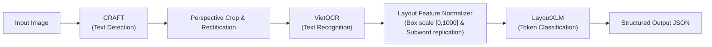

# Week 3 Progress Report: AI Invoice Intelligence

**Project Title:** AI-Powered Vietnamese Invoice Recognition & Information Extraction (`ai-invoice-intelligence`)  
**Reporting Period:** Week 3  
**Authors:** AI Invoice Intelligence Engineering Team  
**Primary Execution Environment:** Kaggle (GPU: P100 / T4 x2)

---

## 1. Executive Summary

During Week 3, the project transitioned from initial concept to an established, production-grade repository architecture with verified data governance. Key achievements for this sprint include:

1. **Repository & Governance Setup:** Established a clean, modular repository layout with strict `.gitignore` enforcement preventing data or credential leakage to Git.
2. **Dataset Audit & Anomaly Resolution:** Verified the MC-OCR 2021 dataset schema from physical files. Uncovered and engineered solutions for real-world anomalies:
   - Fixed raw label typo (`TOTAL_TOTAL_COST` $\to$ `TOTAL_COST` in row 8).
   - Gracefully handled zero-annotation records (rows 1011 and 1091).
   - Validated 100% alignment across 1,155 receipt images and ground-truth text spans.
3. **Critical Architectural Upgrade:** Identified a fundamental blocker in vanilla `LayoutLMv1` (English WordPiece tokenizer fragmenting Vietnamese accents into `[UNK]`) and formally upgraded the information extraction model to **LayoutXLM** (`microsoft/layoutxlm-base`), which natively supports multilingual document semantics and Vietnamese diacritics.
4. **Kaggle EDA Pipeline:** Developed an automated exploratory notebook (`01_mc_ocr_eda.ipynb`) designed to execute seamlessly in Kaggle with dynamic dataset resolution and export of machine-readable data quality reports.
5. **Quality Assurance:** Developed and verified a unit test suite (`tests/`) covering bounding box normalization to $[0, 1000]$, IoU computations, schema mappings, and robust CSV parsing.

---

## 2. Dataset Verification & Quality Audit (MC-OCR 2021)

Through physical inspection of the unpacked competition archive and programmatic validation across all 1,155 training instances, the dataset characteristics are verified as follows:

| Metric | Verified Quantity | Observation |
| :--- | :--- | :--- |
| **Total Images (Train)** | 1,155 | Stored in nested directory `train_images/train_images/*.jpg` |
| **Total Images (Public Val)** | 391 | Stored in nested directory `val_images/val_images/*.jpg` |
| **CSV Annotation Records** | 1,155 | Exact 1:1 match between CSV rows and disk images |
| **Valid Annotation Records** | 1,153 | Records with valid polygon, text, and label alignments |
| **Empty Annotation Records** | 2 | `mcocr_public_145014iwhec.jpg`, `mcocr_public_145014jndnz.jpg` (`anno_num = 0`) |
| **Length Alignment Mismatches** | 0 | Every non-empty row has equal counts of polygons, texts, and labels |
| **Corrupted / Unreadable Images** | 0 | All sample images read successfully via PIL |

### Ground-Truth Entity Distributions
- **`SELLER`**: 1,171 instances (store, company, or brand name)
- **`ADDRESS`**: 1,952 instances (street, ward, district, city)
- **`TIMESTAMP`**: 1,347 instances (date and transaction time)
- **`TOTAL_COST`**: 2,115 instances (total monetary amount paid, including header tags like `"Tổng cộng"`)

---

## 3. Architecture Specification & Decisions



### Justification of LayoutXLM Upgrade
- **Original Proposal:** `LayoutLMv1`.
- **Identified Failure Mode:** LayoutLMv1 is built on `bert-base-uncased` WordPiece vocabulary, which lacks accented Vietnamese characters (`ă`, `â`, `đ`, `ê`, `ô`, `ơ`, `ư`, tonal diacritics). Accented words break into single ASCII characters or `[UNK]`.
- **Approved Solution:** `LayoutXLM` (`microsoft/layoutxlm-base`) utilizes XLM-RoBERTa SentencePiece tokenizer trained on multilingual corpora including Vietnamese, natively preserving semantic tokens while capturing 2D spatial coordinates.

---

## 4. Test Suite Execution & Verification

A localized unit test suite was implemented and validated using Python's standard `unittest` framework:

```text
Ran 15 tests in 0.001s
OK
```

### Verified Components
1. `tests/test_bbox_utils.py`:
   - `test_polygon_to_bbox_standard` & `test_polygon_to_bbox_nested`: Verifies flat and nested polygon conversion to COCO $[x, y, w, h]$.
   - `test_normalize_bbox_xywh`: Verifies scaling from image pixels to $[0, 1000]$ integer coordinates for LayoutXLM.
   - `test_normalize_bbox_clamping_and_invariants`: Verifies clamping and monotonic assertion ($x_0 \le x_1$, $y_0 \le y_1$).
   - `test_denormalize_bbox`: Verifies round-trip coordinate inversion.
   - `test_compute_iou_*`: Verifies IoU accuracy for identical, partial, and disjoint boxes.
2. `tests/test_annotation_parser.py`:
   - `test_parse_valid_row`: Validates normal multi-annotation records.
   - `test_parse_anomaly_label_normalization`: Confirms automatic normalization of `TOTAL_TOTAL_COST` $\to$ `TOTAL_COST`.
   - `test_parse_empty_row`: Confirms handling of rows where `anno_num == 0`.
   - `test_parse_length_mismatch`: Confirms proper error flagging on desynchronized fields.
3. `tests/test_schema.py`:
   - `test_schema_cardinality`: Confirms 9-class BIO schema.
   - `test_bijective_mapping`: Confirms bijective ID-to-Label mapping.
   - `test_get_bio_label`: Confirms prefix assignment (`B-` vs `I-`) and background fallback.

---

## 5. Team Member Task Allocation & Progress

| Member | Role | Completed Tasks (Week 3) | Target Deliverable (Week 4) |
| :--- | :--- | :--- | :--- |
| **Member 1** | Lead & Architecture | Repo scaffolding, Git governance, `.gitignore`, architecture docs, test suite | End-to-end pipeline orchestrator and API contracts |
| **Member 2** | Data Engineering | Kaggle EDA notebook, dataset schema audit, anomaly fixes | Store-grouped leakage-free train/val splits and BIO data loader |
| **Member 3** | Vision & OCR | Input resolution benchmarking, CRAFT crop-rectification interface | CRAFT text detection benchmark and VietOCR CER/WER baseline |
| **Member 4** | Information Extraction | BIO labeling schema, LayoutXLM coordinate normalization tests | LayoutXLM fine-tuning notebook on Kaggle GPU and F1 evaluator |

---

## 6. Blockers, Risks & Next Actions

### Active Blockers
- None at this stage. Local foundations, tests, and Kaggle exploration tools are verified and operational.

### Monitored Risks
1. **Kaggle GPU Quotas:** Team members are allocated 30 GPU hours/week each; notebook runs will be modularized and intermediate OCR outputs will be cached.
2. **Missing Ground Truth for Non-Key Text:** Since `mcocr_train_df.csv` only labels the 4 key entities, CRAFT predictions will be used during inference to provide complete receipt context to LayoutXLM.

### Exact Next Actions for Week 4
1. Upload `notebooks/kaggle/01_mc_ocr_eda.ipynb` to Kaggle, run it with `domixi1989/vietnamese-receipts-mc-ocr-2021` attached, and export the finalized quality report.
2. Implement store-based grouped splitting (`src/preprocessing/split_utils.py`) to prevent franchise template leakage.
3. Develop the CRAFT + VietOCR integration notebook on Kaggle GPU.
